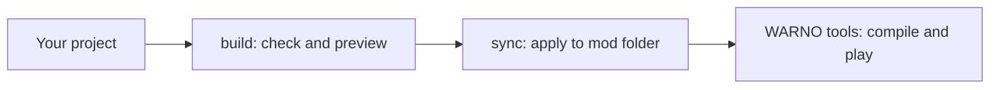

# YMB · Yokaiste's Mod Builder

[**Download for Windows**](https://github.com/Yokaiste/YMB/releases/latest) · [**Documentation**](docs/README.md) · [**YSM Community**](https://discord.gg/33Sqn6dTjf)

## Keep your changes through game updates

You change a weapon. WARNO updates the file. Now you have two versions and an evening of spot-the-difference.

YMB keeps your edits as rules and applies them to current game data. Change one unit, adjust a roster, or combine compatible projects. When an update removes something your rule needs, YMB points to the patch that needs attention.

- Edit named objects or change a whole roster. Set expected match counts so a game update that removes a target gets flagged. [Patch and settings reference](docs/README.md#reference)
- Reuse settings and calculations across patches, and keep personal overrides in a local file.
- Keep balance rules, interface changes, and assets in selectable patches. Set the order when projects change the same files. [Project layering](docs/README.md#advanced)
- Write Rust generators for rules that need code. Players can run the precompiled versions without Rust. [Generator lessons](docs/README.md#advanced)

Use `find` to locate game objects, `explain` to see what your selection includes, and `--json` for scripts.

## Check before applying

Sync saves originals before applying changes. Recovery restores them and removes YMB's additions. Unexpected manual changes to tracked files stop the operation with a diagnostic.

The Windows download includes the executable and SDK. Normal use needs no compiler or separate runtime. Whole-file replacements still need comparing after game updates.

## Made with YMB

- Expanded rosters, Zombie Horde, and sandbox units. [Yokaiste's Sandbox Mod](https://github.com/Yokaiste/YSM)
- Revised weapon roles, movement, vision, and combat pacing. Play it alone or combine it with YSM. [WARNO Tactical Overhaul](https://github.com/Yokaiste/WTO)

## Learn by building a real mod

Build a tank-training mod from a fresh WARNO folder. Add your menu title, tune two real tanks, and make their settings adjustable. Each lesson includes an experiment and a result to check. No previous modding or programming experience required.

[Start the beginner course](docs/README.md#beginner-course) · [Work with an existing project](docs/README.md#everyday-tasks)

## License and help

YMB is source-available under its [custom license](LICENSE). You can build and publish mods, including commercial mods, and modify your private copy. Public mods must credit YMB with a working link. Redistributing YMB itself requires written permission.

See [NOTICE](NOTICE) for the summary and `THIRD_PARTY_NOTICES.md` in the download for bundled software.

Use the troubleshooting forum in [YSM Community Discord](https://discord.gg/33Sqn6dTjf) for help and bug reports.
