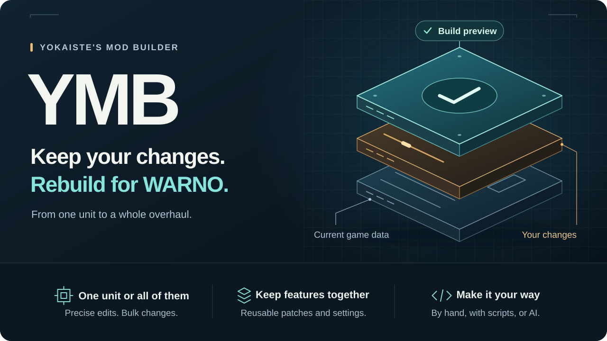
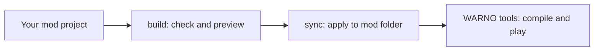

# YMB · Yokaiste's Mod Builder

Make the WARNO mod you want. Spend less time repairing it after updates.

[**Download for Windows**](https://github.com/Yokaiste/YMB/releases/latest) · [**Make your first mod**](docs/getting-started.md) · [**YSM Community**](https://discord.gg/33Sqn6dTjf)

## Keep your changes through game updates

You change a weapon. WARNO updates the file. Now you have two versions and an evening of spot-the-difference.

YMB saves your changes as instructions: find this unit, change that value, give these weapons a little more range. It applies those instructions to the current game data and builds the files for you. When an update moves or removes something you use, YMB points to the patch that needs attention.

Start with a few settings in a text file. Add scripts when your mod needs them.

<table>
<tr>
<td width="50%" valign="top">

### Change one unit or a whole roster

Edit a named object, clone it, or apply a rule to every match. Set a minimum match count so a rule fails when expected units disappear after an update.

[Patches and bulk edits](docs/ndf-operations.md)

</td>
<td width="50%" valign="top">

### Put your settings in one place

Reuse values across patches, scripts, and file templates. Keep personal overrides separate from a mod project's defaults, ready for the next update.

[Settings and customization](docs/configuration.md#customizing-installed-mods)

</td>
</tr>
<tr>
<td valign="top">

### Build features that fit together

Organize balance, interface changes, and assets into selectable patches. Combine compatible projects in one build; see which changes collide when they don't agree.

[Combining projects](docs/advanced.md)

</td>
<td valign="top">

### Generate the repetitive parts

Use TypeScript to produce decks, descriptors, and other content. YMB supplies game-file readers, NDF editing tools, checks, and caches.

[Generation scripts](docs/script-tools.md)

</td>
</tr>
</table>

## Check it before it reaches the game

A build checks your configuration, patches, generated NDF, and script tests, then writes a preview you can inspect. Sync saves the original files before applying your changes. Recovery puts those originals back and removes YMB's additions.

YMB also detects manual edits to tracked files. If a file changed unexpectedly, it stops and tells you where to look.

## Work by hand, with scripts, or with an AI agent

Find objects in large game files without scrolling through thousands of lines. Ask why a patch was skipped. Build one feature while you work on it. Reuse cached work on the next run.

The same commands have a `--json` mode for scripts and AI agents, with structured results and errors. Mod projects stay separate from the builder, so your own code and settings have a clear home.

[Command guide](docs/workflow.md) · [Automation](docs/workflow.md#scripting-ymb)

## Made with YMB

| Project                                                    | What you can play                                                                      |
| ---------------------------------------------------------- | -------------------------------------------------------------------------------------- |
| [Yokaiste's Sandbox Mod](https://github.com/Yokaiste/YSM)  | Unlimited and Balanced rosters, Zombie Horde, special weapons, and sandbox tools.      |
| [WARNO Tactical Overhaul](https://github.com/Yokaiste/WTO) | Changes to weapon roles, movement, vision, and combat pacing. Can also layer over YSM. |

Each mod is its own project with its own settings and license. YMB is the builder they use.

## Your first build

1. Create a WARNO mod folder with the game's modding tools.
2. Download the **full Windows archive** and extract its `YMB` folder beside `GameData` and `CommonData`. Bun is included; you don't need to install it.
3. Open `YMB.bat`, run `init`, then `build`. You'll get a working starter project and a preview.

Follow [the first-build guide](docs/getting-started.md) to put your title on WARNO's menu. Keep that project and give an Abrams more HP, expand the change to several units, then try a bulk rule for the whole roster. Each lesson leaves you with a change you can compile and play. For an existing project, put its folder in `YMB/mods/` and follow its setup instructions.

YMB helps you maintain changes across updates. It cannot guarantee that every update or combination of mods will work unchanged. Whole-file replacements still need comparing with new game data.

## License and help

YMB is source-available under its [custom license](LICENSE). You can use it to build and publish mods, including commercial mods, and modify your private copy. Public mods built with YMB must credit it with a working link. Redistributing YMB itself requires written permission. See [NOTICE](NOTICE) for the summary and `THIRD-PARTY-NOTICES.md` in the download for bundled software.

Get help, share feedback, and report bugs in [YSM Community Discord](https://discord.gg/33Sqn6dTjf). Use its troubleshooting forum when something breaks.

---

Building something with YMB? [Star the repository](https://github.com/Yokaiste/YMB).
