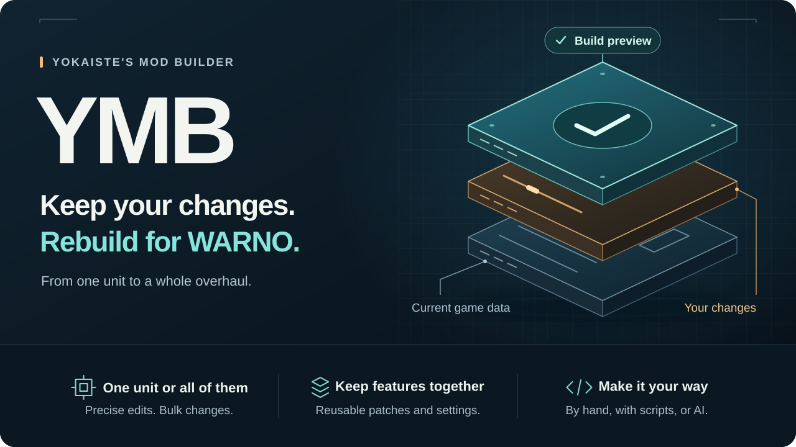
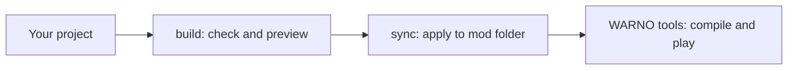
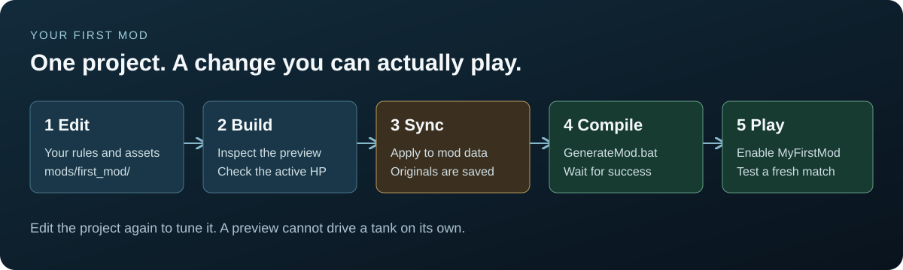

# YMB · Yokaiste's Mod Builder

[**Download for Windows**](https://github.com/Yokaiste/YMB/releases/latest) · [**Documentation**](docs/README.md) · [**YSM Community**](https://discord.gg/33Sqn6dTjf)

## Keep your changes through game updates

You change a weapon. WARNO updates the file. Now you have two versions and an evening of spot-the-difference.

YMB keeps your edits as rules and applies them to current game data. Change one unit, adjust a roster, or combine compatible projects. When an update removes something your rule needs, YMB points to the patch that needs attention.

<table>
<tr>
<td width="50%" valign="top">

### Change one unit or a whole roster

Edit, add, remove, or copy named objects. Apply bulk rules with expected match counts to catch missing targets after an update.

[Patches and bulk edits](docs/README.md#reference)

</td>
<td width="50%" valign="top">

### Put your settings in one place

Reuse values and calculations across features. Keep personal overrides separate from the project's defaults.

[Settings and customization](docs/README.md#reference)

</td>
</tr>
<tr>
<td valign="top">

### Build features that fit together

Keep balance, interface changes, and assets in selectable patches. Combine projects in a deliberate order and inspect conflicts when their changes overlap.

[Features and project layering](docs/README.md#advanced)

</td>
<td valign="top">

### Generate the repetitive parts

For advanced rules, write Rust generators with shared NDF tools, checks, and caches. Users can run precompiled generators without Rust.

[Optional generator lessons](docs/README.md#advanced)

</td>
</tr>
</table>

Use `find` to locate objects, `explain` to inspect selections, and `--json` for scripts and AI tools.

## Check before applying

Sync saves originals before applying changes. Recovery restores them and removes YMB's additions. Unexpected manual changes to tracked files stop the operation with a diagnostic.

The Windows download includes the executable and SDK. Normal use needs no compiler or separate runtime. Whole-file replacements still need comparing after game updates.

## Made with YMB

| Project | What you can play |
| --- | --- |
| [Yokaiste's Sandbox Mod](https://github.com/Yokaiste/YSM) | Expanded rosters, Zombie Horde, special weapons, and sandbox tools |
| [WARNO Tactical Overhaul](https://github.com/Yokaiste/WTO) | Revised weapon roles, movement, vision, and combat pacing; can also layer over YSM |

## Learn by building a real mod

Build a tank-training mod from a fresh WARNO folder. Add your menu title, tune two real tanks, and make their settings adjustable. Each lesson includes an experiment and a result to check. No previous modding or programming experience required.

[Start the beginner course](docs/README.md#beginner-course) · [Work with an existing project](docs/README.md#everyday-tasks)

## License and help

YMB is source-available under its [custom license](LICENSE). You can build and publish mods, including commercial mods, and modify your private copy. Public mods must credit YMB with a working link. Redistributing YMB itself requires written permission.

See [NOTICE](NOTICE) for the summary and `THIRD_PARTY_NOTICES.md` in the download for bundled software.

Use the troubleshooting forum in [YSM Community Discord](https://discord.gg/33Sqn6dTjf) for help and bug reports.
