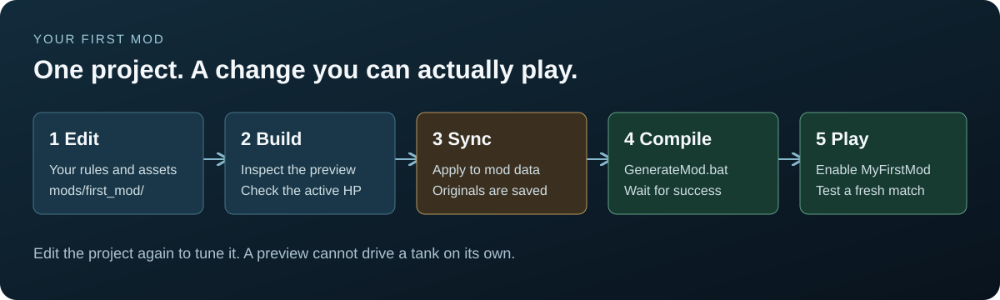

# YMB documentation

| Previous | You are here | Next |
| --- | --- | --- |
| [About YMB](../README.md) | Documentation | [0. Meet your mod folder](learn/00-warno-basics.md) |

Start with the beginner course to build a tank-training mod from a fresh WARNO folder. You will add a menu title, tune real tanks, make settings, and combine an optional add-on. No programming experience or Rust installation required.

[Beginner course](#beginner-course) · [Everyday tasks](#everyday-tasks) · [Reference](#reference) · [Advanced](#advanced) · [Further reading](#further-reading)

## Beginner course

Follow the lessons in order, keeping the same project. Each gives you a complete edit, an expected result, and an experiment to try. Use PowerShell inside `YMB/` unless a step names another folder. The lessons use no YSM or WTO files.

| Lesson | Your result |
| --- | --- |
| [0. Meet your mod folder](learn/00-warno-basics.md) | Understand game data, descriptors, and the build cycle |
| [1. Put your title in WARNO](learn/01-first-build.md) | Your title on the welcome screen |
| [2. Change unit health](learn/02-unit-health.md) | A stronger M1A1, then loop and bulk experiments |
| [3. Make features adjustable](learn/03-settings.md) | Local choices, feature switches, and development scope |
| [4. Calculate from current game values](learn/04-calculations.md) | Two tanks scaled from their own original values |
| [5. Finish the menu and own its assets](learn/05-menu-and-assets.md) | A smaller title, useful hint, and feature-owned CSV |
| [6. Add an optional training project](learn/06-combine-projects.md) | An add-on with explicit build order |
| [7. Rebuild, recover, and share your mod](learn/07-maintain-and-share.md) | Recovery, repeatable builds, and a project others can use |

The game will not notice a preview sitting politely on your disk: sync, compile, then enable the mod.

## Everyday tasks

Use these when you already have a project.

| Guide | Task |
| --- | --- |
| [Build, apply, and play](guides/build-and-play.md) | Preview, select features, sync, compile, and play |
| [Update, undo, and clean up](guides/update-and-recover.md) | Restore originals, refresh game data, and reclaim disposable work |
| [Find and fix a failed change](guides/troubleshooting.md) | Locate the failing stage and act on its diagnostic |

## Reference

Look up an exact command, setting, or operation.

| Page | Covers |
| --- | --- |
| [NDF selectors and operations](references/ndf-patches.md) | Selectors, operation shapes, matching, and value types |
| [Project files, settings, and assets](references/configuration.md) | Project and patch schemas, overrides, assets, and limits |
| [Variables, expressions, and helpers](references/expressions.md) | Variables, calculations, helpers, and `readValues` |
| [Commands and JSON output](references/commands.md) | CLI options, interactive behavior, and structured results |
| [Errors, warnings, and message codes](references/message-codes.md) | Stable codes, severity, targets, and suggested actions |

## Advanced

The beginner course produces a complete mod through configuration. Writing programs is optional; your tanks will not ask for your GitHub profile.

| Page | Before you start / purpose |
| --- | --- |
| [Write and test a health generator](advanced/health-generator.md) | **Rust lesson.** Finish the beginner course and learn basic Rust |
| [Generator SDK and execution](references/generators.md) | **Coding reference.** Registration, staged output, tests, ownership, and caches |
| [Use YMB from scripts and AI tools](advanced/automation.md) | **Scripting guide.** Requires basic PowerShell and JSON |
| [Executable plugin protocol](references/plugin-protocol.md) | **Coding reference.** Framing, handshake, requests, and checked payloads |
| [Layering, ownership, and large projects](advanced/composition.md) | Dependencies, overlapping writers, caches, and performance |
| [Recovery records and interrupted writes](advanced/recovery.md) | Manifests, original bytes, locks, and rollback rules |
| [Package and share your mod](advanced/mod-releases.md) | Prepare a ZIP or installer and share it |

## Further reading

[Game manuals, language guides, and community help](resources.md) explains where to look and when each resource helps. The Rust material is for the optional advanced lessons.

| Previous | You are here | Next |
| --- | --- | --- |
| [About YMB](../README.md) | Documentation | [0. Meet your mod folder](learn/00-warno-basics.md) |
