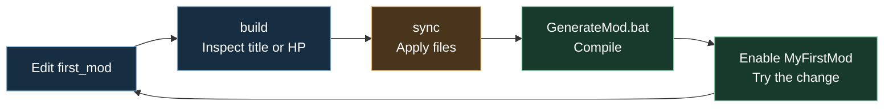

# Make your first WARNO mod

[Download YMB](https://github.com/Yokaiste/YMB/releases/latest) · [About YMB](../README.md) · [Community help](https://discord.gg/33Sqn6dTjf)

Put your own title on WARNO's main menu, then give an Abrams more HP. Keep the same project as you learn to change several units, apply a rule across the roster, and make settings you can tune between matches.

You need WARNO's modding tools and a text editor. The first lessons use YAML; programming comes later, when you have a reason to use it.

## Build a mod you can play

Follow the lessons in order. Each one works in `MyFirstMod/YMB/mods/first_mod/` and tells you what to keep, add, or replace.

| Lesson                                               | What you make                                                    | What you learn                                                                 |
| ---------------------------------------------------- | ---------------------------------------------------------------- | ------------------------------------------------------------------------------ |
| [1. Your title in the game](getting-started.md)      | A welcome-screen title with your mod's name                      | Install, `init`, preview, apply, compile, and enable                           |
| [2. Change unit health](ndf-operations.md)           | A tougher M1A1 Abrams, then selected units or a bulk health rule | Find real objects, select nested fields, write patches, and verify their reach |
| [3. Control your features](configuration.md)         | Local settings and selectable features for the same mod          | Project layout, overrides, scopes, dependencies, assets, and file operations   |
| [4. Calculate your changes](template-expressions.md) | Health settings based on current game values                     | Variables, `readValues`, expressions, and repeated edits                       |
| [5. Write a useful script](script-tools.md)          | A generated change in the same project                           | Script inputs, game-file tools, output, and focused checks                     |
| [6. Combine and maintain changes](advanced.md)       | Explicitly ordered changes that can share game files             | Ownership, layering, caching, and recovery                                     |

The [workflow guide](workflow.md) stays beside you through every lesson: command reference, updates, undo, troubleshooting, and automation.

These exercises change actual WARNO data. Build in the fresh mod folder from lesson 1. The tutorials do not depend on YSM or WTO, and you do not need to edit either project.

## From an edit to the game

A **mod project** is the editable folder under `YMB/mods/`. A **patch** is one selectable change inside it. The **WARNO mod folder** holds `GameData` and `CommonData`, where YMB applies your output.

`build` creates a **preview**. `sync` rebuilds and applies the files. WARNO's tools then **compile** them into a playable mod. After the first menu-title check, use that same cycle for every gameplay change.

## Where to edit

| Location inside `YMB/`   | What it holds                               |
| ------------------------ | ------------------------------------------- |
| `mods/first_mod/config/` | Your defaults, patches, scripts, and assets |
| `ymb.config.yaml`        | Your local overrides and YMB paths          |
| `.ymb-build/output/`     | The latest preview; rebuilding replaces it  |
| `.ymb-state/`            | Originals and records needed to undo a sync |

Edit the project or your local overrides. Editing the preview is a remarkably efficient way to lose an afternoon's work on the next build.

Already have a mod project? Use [local customization](configuration.md#customizing-installed-mods) and its author's guide. For a failed command, open [troubleshooting](workflow.md#when-something-goes-wrong).

Commands in the lessons use the shell opened by `YMB.bat`. [Command forms](getting-started.md#where-to-type-commands) covers PowerShell and source checkouts; [JSON output](workflow.md#scripting-ymb) covers scripts and AI agents.
