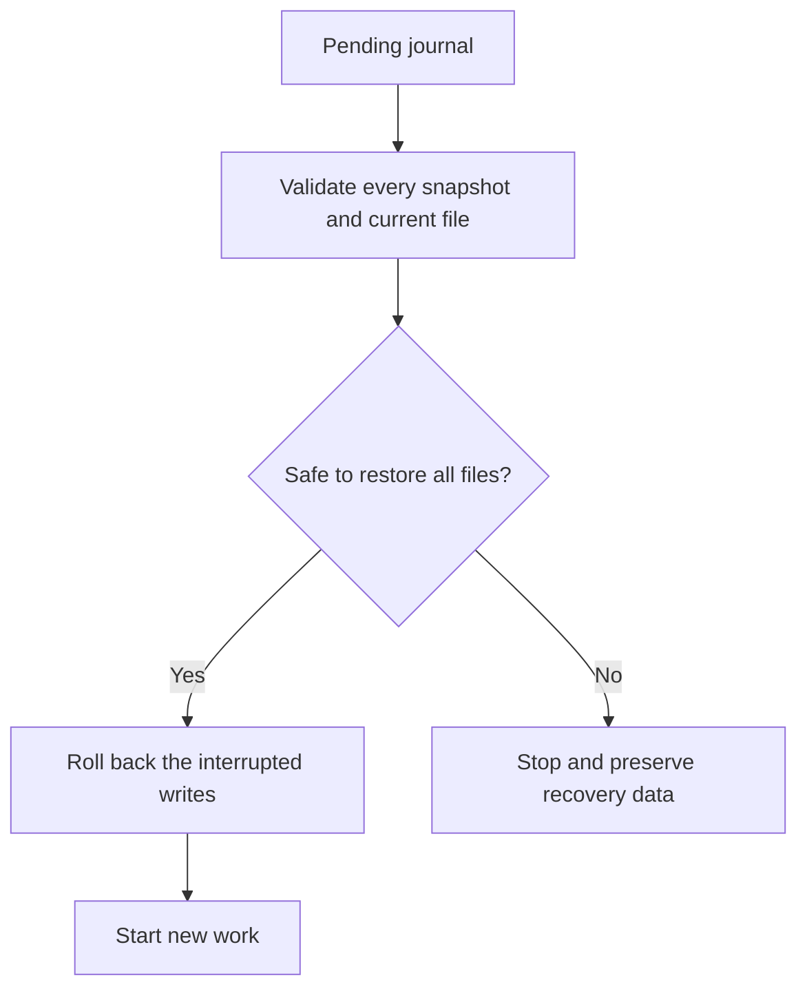

# Recovery records and interrupted writes

[All documentation](../README.md#advanced)

| Previous | You are here | Next |
| --- | --- | --- |
| [Layering, ownership, and large projects](composition.md) | Advanced · 2/3 · Recovery records and interrupted writes | [Package and share your mod](mod-releases.md) |

[Upgrade storage paths](#upgrade-storage-paths) · [Interrupted operations](#interrupted-operations) · [Common failures](#common-failures)

For normal undo and updates, use [update and recovery](../guides/update-and-recover.md). Read this page when you need the storage and transaction rules.

## What is saved

| Record | Contents |
| --- | --- |
| .ymb/state/manifest.json | Owners, expected state, original hash, synced hash for each tracked file |
| .ymb/state/originals | Exact original bytes; a YMB-created file has an absent original |
| .ymb/transaction | Snapshots for rolling back an interrupted operation |

Manifests and journals have the same 64 MiB read/write limit. Oversized updates fail and roll back, keeping recovery data readable by the next command.

| Operation | File behavior |
| --- | --- |
| Sync | Write changed targets; update ownership even when bytes are equal |
| File leaves the selected build | Restore its original |
| Recover a contributor | Restore the whole matching file, including other contributors' changes |
| Recover a YMB-created file | Remove it |
| Repeat unchanged sync | No game-file writes |

External edits stop sync or recovery. Save them before --reset-changed. A file manually returned to its saved original is safe to sync again.

> [!WARNING]
> Keep saved originals. Missing, corrupt, or orphaned recovery data needs a trusted backup. Editing a manifest to dodge a checksum failure does not repair the bytes.

Doctor inspects recovery even with broken project YAML. Recover and doctor can read version 1 builder paths without loading old projects or generators. Recovery can recreate missing GameData and CommonData from originals; build and sync require current configs.

Cleanup retains originals. cleanup --all refuses to discard live recovery data.

## Upgrade storage paths

Defaults are .ymb/build for previews, .ymb/cache for results, and .ymb/state for originals.

1. Finish any pending operation with the previous builder.
2. Move .ymb-state to .ymb/state with its contents intact. Old previews and caches can be discarded.
3. Update explicit paths in ymb.config.yaml if needed, then run doctor.

YMB stops builds that would ignore legacy recovery. The YSM installer moves the old default recovery folder during its staged update.

## Interrupted operations

The operation lock prevents concurrent writers. Its owner record includes host,
process id, token, command, and start time. Live or foreign-host locks are kept.
A stale local lock is rechecked under a reclamation guard before replacement.

The journal snapshots each file before its first mutation: game files, authored generator writes, recovery records, and preview directory swaps. Snapshots have checksums. Version 3 also records expected write and deletion results.

Before a writing command starts new work:

No file is restored until the whole set passes. Edits made after interruption stop rollback; --reset-changed cannot bypass that check.

| Command | Pending journal behavior |
| --- | --- |
| Command that writes output | Roll back before new work; clean committed journals |
| Validation or dry run | Stop and leave it untouched |
| Doctor, list, explain, find | Inspect without restoring as a side effect |

Legacy originals, whole-file markers, and version 1/2 journals remain readable. Old file journals lack expected write results and refuse unknown current files. Save later edits and restore the saved preimage from a trusted backup before retrying. Deleting the journal removes the recovery plan, not the problem.

A journal whose roots no longer match configuration must be recovered using the
original roots. Do not move the builder or change roots during an interrupted
operation. A damaged rollback snapshot needs restoration from another backup.

## Common failures

| Failure | Action |
| --- | --- |
| Missing GameData or CommonData | Create a WARNO mod and point paths.gameRoot at it |
| Unsupported config version | Update that project's configuration to the supported format |
| Missing optional target | Check skipped patches; use --require-all before distribution |
| Conflict | Compare the saved conflict files, keep edits disjoint, or declare deliberate layering |
| Generator compile error | Fix the owning Cargo project, or register a compatible precompiled executable |
| Generator timeout | Fix unbounded work or adjust the measured deadline |
| Changed tracked target | Save external edits, then recover or sync with --reset-changed |
| Damaged backup or journal | Restore the named recovery data from a trusted backup |
| Game rejects valid NDF | Run WARNO's compiler and inspect its type/resource diagnostics |

Uncommentable and byte-exact assets use manifest tracking without in-file
markers. They have the same backup and checksum protections.

| Previous | You are here | Next |
| --- | --- | --- |
| [Layering, ownership, and large projects](composition.md) | Advanced · 2/3 · Recovery records and interrupted writes | [Package and share your mod](mod-releases.md) |
