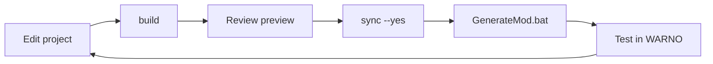

# Build, apply, and play

[All documentation](../README.md#everyday-tasks)

| Previous | You are here | Next |
| --- | --- | --- |
| [Everyday tasks](../README.md#everyday-tasks) | Guides · 1/3 · Build, apply, and play | [Update, undo, and clean up](update-and-recover.md) |

[Choose a command](#choose-a-command) · [Preview before applying](#preview-before-applying) · [Choose projects and patches](#choose-projects-and-patches) · [Read progress and findings](#read-progress-and-findings)

Edit, build, inspect, sync the same selection, then compile and test. If you need a project first, start with [the menu-title lesson](../learn/01-first-build.md).



## Choose a command

| Command         | Result                                                               |
| --------------- | -------------------------------------------------------------------- |
| `doctor`        | Shows resolved paths and the state of synced files         |
| `list`          | Lists discovered mod projects and patches                            |
| `explain`       | Explains why patches are included or skipped                         |
| `find`          | Searches NDF blocks by name, type, or field                          |
| `validate`      | Runs build checks without replacing the preview                      |
| `build`         | Runs checks and writes `.ymb/build/output`                           |
| `sync --yes`    | Rebuilds, saves originals, and applies files to the WARNO mod folder |
| `recover --yes` | Restores tracked originals and removes generated additions           |
| `cleanup`       | Removes disposable previews and caches                               |
| `init`          | Creates a starter project                                            |

Use `<command> --help` for its options. Run these commands in PowerShell inside YMB. See [command forms](../learn/01-first-build.md#where-to-type-commands).

Build and validation leave `GameData` and `CommonData` unchanged. Build commits successful staged project writes; validate and dry runs discard them. Generators still execute trusted code with access beyond the SDK.

## Preview before applying

```text
.\YMB.exe build --mod first_mod
```

Open the reported preview folder. It contains the files YMB would apply; removals appear in `deletions.json`. Check both when your patch deletes anything.

| Tutorial change | Check in the preview |
| --- | --- |
| Menu title | `GameData/Localisation/MyFirstMod/INTERFACE_OUTGAME.csv`: your title text |
| Unit health | `GameData/Generated/Gameplay/TacticalUnits.ndf`: find `Descriptor_Unit_M1A1_Abrams_US`, then `MaxPhysicalDamages` in `TBaseDamageModuleDescriptor`; the first exercise changes `10` to `20` |

```text
.\YMB.exe sync --mod first_mod --yes
```

Sync rebuilds from your current settings. If you edited the project after reviewing its preview, those newer changes are included. Keep the same filters when applying the build you reviewed.

After sync, run `GenerateMod.bat` from the WARNO mod folder and enable the compiled mod in game. YMB does not run WARNO's compiler.

Check the welcome title, inspect affected units in the armory, and try a fresh skirmish. Compare the same units and conditions: extra HP leaves armor unchanged, and damage still depends on the shot. If health looks unchanged, check the edited descriptor against the selected unit variant.

## Choose projects and patches

```text
.\YMB.exe build --mod first_mod
.\YMB.exe build --mod first_mod --patch gameplay.health
.\YMB.exe build --mod first_mod --patch welcome_title --patch gameplay.health
.\YMB.exe build --mod first_mod --scope dev
```

Filters match exact ids or display names. Prefer ids in saved commands. Repeat `--mod` or `--patch` to select several; `--scope dev` includes both `prod` and `dev` patches.

Use patch filters for investigation, then build and sync `--mod first_mod` for the complete tutorial. To disable a feature, change `enabled` as shown in [configuration](../references/configuration.md), then sync the whole project. Sync stops if the selection would erase an excluded contributor from a shared file. To replace an installed combination, recover its shared files first, then sync the new selection.

Required dependencies are included automatically; missing or disabled ones fail. Unknown filters fail build, validate, sync, and searches of selected targets. List and explain warn about unmatched filters so you can correct the selection.

## Read progress and findings

Interactive progress reports the current project, target work, generators, and elapsed time. Read diagnostic counts even when the command succeeds: a rule may be redundant, a filter may match nothing, or an optional patch may be absent. Use --verbose for details and --no-cache to rule out derived cache work.

For failures, use [troubleshooting](troubleshooting.md). For writes to undo, use [recovery](update-and-recover.md).

| Previous | You are here | Next |
| --- | --- | --- |
| [Everyday tasks](../README.md#everyday-tasks) | Guides · 1/3 · Build, apply, and play | [Update, undo, and clean up](update-and-recover.md) |
