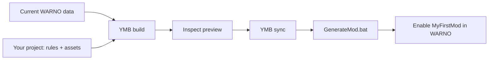

# 0. Meet your mod folder

[All documentation](../README.md#beginner-course)

| Previous | You are here | Next |
| --- | --- | --- |
| [Learn by building a mod](../README.md#beginner-course) | Learn · 0. Meet your mod folder | [1. Put your title in WARNO](01-first-build.md) |

You will build a small tank-training mod: your own welcome title, tougher Abrams tanks, adjustable settings, and an optional training add-on. No previous modding or programming is required. The whole beginner course uses configuration files and supplied commands. Writing programs has its own optional [advanced track](../README.md#advanced).

## What WARNO actually loads

WARNO's editable data describes units, weapons, menus, and resources. Its tools compile that data into a playable mod. Editing a text file alone does not update the game. Yes, there is a compile button between you and your extremely reasonable tank.

| Term | Meaning | Example in this course |
| --- | --- | --- |
| WARNO mod folder | A copy made by the game's tools; holds game data and compile scripts | `WARNO/Mods/MyFirstMod/` |
| Mod project | Your editable YMB rules and assets | `MyFirstMod/YMB/mods/first_mod/` |
| Patch | One selectable feature inside a project | `gameplay.health` |
| NDF | WARNO's text format for objects and their properties | `TacticalUnits.ndf` |
| Descriptor | A named object describing a unit, weapon, or other game object | `Descriptor_Unit_M1A1_Abrams_US` |
| Localisation | Text stored under stable keys, then referenced by the interface | Your welcome title |
| Preview | Files YMB prepared for review | `YMB/.ymb/build/output/` |



## Why keep rules instead of edited game files?

| Job | Editing game files by hand | With YMB |
| --- | --- | --- |
| Change two tanks | Find both values and remember what you changed | Keep the exact names and one setting in a patch |
| Apply a game update | Compare your edited file with the new version | Run the rules against refreshed originals; fix reported mismatches |
| Try another balance setting | Repeat edits, then keep track of the versions | Change a local override and rebuild |
| Undo the experiment | Find your backup and remember which files belong to it | Preview recovery, then restore saved originals |

Manually maintaining a whole unit file means reviewing unrelated changes too. That is a lot of scrolling for two tanks. YMB still needs your judgement when fields disappear, rules overlap, or the game rejects a value. Whole-file replacements still carry the whole maintenance bill.

## Read a little NDF

This shortened illustration shows the structure you will inspect in lesson 2; do not paste it over a game file:

```ndf
export Descriptor_Unit_M1A1_Abrams_US is TEntityDescriptor
(
    ModulesDescriptors = [
        TBaseDamageModuleDescriptor
        (
            MaxPhysicalDamages = 10
        ),
    ]
)
```

| NDF part | Meaning |
| --- | --- |
| Descriptor name | One unit variant |
| `TEntityDescriptor` | Its type |
| Parentheses | Fields inside an object |
| Square brackets | A list; the damage module is one entry |
| `MaxPhysicalDamages` | Health, despite the bureaucratic name |
| `~/SomeName` | Reference to another object |
| Quoted text | String |
| `//` and `/* ... */` | Line comment and block comment |

YMB configs use YAML: indent with spaces, write `key: value`, and use `-` for list entries. Save as UTF-8.

Turn on file-name extensions in Windows so `ymb.patch.yaml` does not become `ymb.patch.yaml.txt`. The extra `.txt` is small; the resulting confusion is not.

## Get ready

You need installed WARNO, its `Mods` tools, a text editor, and PowerShell. Open WARNO's local files from Steam, then open `Mods`. The supplied `ReadMe.txt`, `modding_manual.pdf`, and `ndf_reference_manual.pdf` are the game's references. Leave `Mods/ModData` intact; it is the template for new mods.

In File Explorer, open the desired folder, type `powershell` in the address bar, and press Enter. Check the prompt's folder before running a command. The next lesson tells you when to switch folders.

### Check yourself

Which file will you edit after a build: the patch in `mods/first_mod/config/`, or the preview in `.ymb/build/output/`?

<details>
<summary>Show the answer</summary>

Edit the patch. The next build replaces the preview. Also keep `.ymb/state/`: it contains saved originals needed for recovery.

</details>

### Read a little further

Open the installed NDF manual when you want more examples of objects and references. [Further reading](../resources.md#warnos-own-manuals) explains where to find the game manuals and when to use each one.

| Previous | You are here | Next |
| --- | --- | --- |
| [Learn by building a mod](../README.md#beginner-course) | Learn · 0. Meet your mod folder | [1. Put your title in WARNO](01-first-build.md) |
