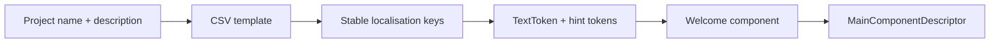

# 5. Finish the menu and own its assets

[All documentation](../README.md#beginner-course)

| Previous | You are here | Next |
| --- | --- | --- |
| [4. Calculate from current game values](04-calculations.md) | Learn · 5. Finish the menu and own its assets | [6. Add an optional training project](06-combine-projects.md) |

Keep the two-tank YAML health patch and local `healthMultiplier: 1.5` unchanged. Make the title smaller, improve its hover hint, and put its text file beside the feature that uses it. Then try copying the menu container and undo that experiment.

## Follow the title from text to screen



The starter's `add` operation inserts a complete `BUCKTextDescriptor`. A localisation key connects that component to the text in the CSV. Copying a descriptor alone does not make WARNO use it; an existing screen or roster must refer to it.

## Give the title a useful hint

In `mods/first_mod/config/ymb.mod.yaml`, set the description to `Base training: M1A1 and M1IP gain 50% health.` Keep its name, id, and token variables. This is display text; later health changes need a matching description edit.

The starter uses commented YAML. Edit its existing `description` entry; quote a value containing a colon followed by a space. The title's tooltip comes from the CSV row using `detailToken`.

## Give layout its own patch

Create `mods/first_mod/config/patch/ui/title-size/ymb.patch.yaml` with the complete file below:

```yaml
version: 2
id: ui.title_size
name: Smaller welcome title
scope: prod
dependsOn:
  - welcome_title
targets:
  - file: GameData/UserInterface/Use/OutGame/UISpecificOutGameWelcomeView.ndf
    operations:
      - op: modify
        selector:
          kind: field
          by: path
          value: UISpecificOutGameWelcomeDescriptor.Components.[ElementName="YmbTitlefirst_mod"].TextSize
        value:
          $string: '40'
```

The dependency makes `welcome_title` run first. Its component must exist before this patch can resize it. `$string` keeps `40` as text because WARNO's `TextSize` expects a string.

Run `.\YMB.exe explain --mod first_mod`, then `.\YMB.exe build --mod first_mod`. Check the active `TextSize` of `YmbTitlefirst_mod` in the welcome NDF: it should be `'40'`. Check the description in the preview CSV too.

## Let the text asset follow the feature

Move the starter CSV from `config/replace/GameData/Localisation/${modRootName}/INTERFACE_OUTGAME.csv` to `config/patch/welcome/assets/INTERFACE_OUTGAME.csv`. The source folder name literally contains `${modRootName}`. Keep the CSV contents unchanged.

Replace the whole `config/patch/welcome/ymb.patch.yaml` with this YAML version. It keeps the starter title and adds the asset copy. The token values still come from `ymb.mod.yaml`; keep those unchanged.

```yaml
version: 2
id: welcome_title
name: Welcome title
scope: prod
files:
  - op: copy
    source:
      root: patch
      path: assets/INTERFACE_OUTGAME.csv
    destination: GameData/Localisation/${modRootName}/INTERFACE_OUTGAME.csv
    expect:
      files: 1
targets:
  - file: GameData/UserInterface/Use/OutGame/UISpecificOutGameWelcomeView.ndf
    operations:
      - op: add
        selector:
          kind: collection
          by: path
          value: UISpecificOutGameWelcomeDescriptor.Components
        value:
          $raw: |
            BUCKTextDescriptor
            (
                ElementName = "YmbTitlefirst_mod"
                ComponentFrame = TUIFramePropertyRTTI
                (
                    MagnifiableWidthHeight = [1500.0, 90.0]
                    AlignementToAnchor = [0.5, 0.15]
                    AlignementToFather = [0.5, 0.15]
                )
                ParagraphStyle = TParagraphStyle
                (
                    VerticalAlignment = ~/UIText_VerticalCenter
                    Alignment = ~/UIText_Center
                )
                TextColor = "ListeExcel/Cartouche"
                TextSize = "50"
                TextStyle = "Default"
                TypefaceToken = "UIMainFont"
                TextDico = ~/LocalisationConstantes/dico_interface_outgame
                TextToken = "${titleToken}"
                Components = [
                    BUCKSpecificHintableArea
                    (
                        HintTitleToken = "${titleToken}"
                        HintBodyToken = "${detailToken}"
                        DicoToken = ~/LocalisationConstantes/dico_interface_outgame
                    ),
                ]
            )
```

Build again. There must be one output CSV at the same destination, containing the title and hint. Moving the source avoids two owners fighting over one file. Very realistic office simulation; poor mod structure.

## Try add, remove, and copy

Append each snippet at the end of that welcome patch, with its `- op` aligned with the existing `- op: add` (six spaces). Build and inspect each result. Remove the appended snippet before trying the next one. Keep the original title-add operation and the `files` entry.

### Add a field

```yaml
      - op: add
        selector:
          kind: field
          by: path
          value: UISpecificOutGameWelcomeDescriptor.Components.[ElementName="YmbTitlefirst_mod"].HorizontalFitStyle
        value: ~/FitStyle/FitToContent
```

The preview title gains `HorizontalFitStyle = ~/FitStyle/FitToContent`. The original title-add operation showed how to insert a list entry; this adds one field. Remove this appended operation and rebuild to undo it.

### Remove the hint

```yaml
      - op: remove
        selector:
          kind: field
          by: path
          value: UISpecificOutGameWelcomeDescriptor.Components.[ElementName="YmbTitlefirst_mod"].Components.[BUCKSpecificHintableArea]
```

The title remains, but its `Components` list has no hint entry. Sync and compile if you want to confirm that hovering no longer shows the description. Remove the appended operation to restore the hint.

### Copy a container and make WARNO use it

```yaml
      - op: copy
        selector:
          kind: object
          by: name
          value: UISpecificOutGameWelcomeDescriptor
        destination:
          name: FirstModWelcomeDescriptor
      - op: modify
        selector:
          kind: field
          by: path
          value: UISpecificOutGameWelcomeViewDescriptor.MainComponentDescriptor
        value: ~/FirstModWelcomeDescriptor
      - op: modify
        selector:
          kind: field
          by: path
          value: FirstModWelcomeDescriptor.Components.[ElementName="YmbTitlefirst_mod"].TextSize
        value:
          $string: '60'
```

Check for the copied block, the view's changed reference, and the copy's title size of 60. All three matter: an unreferenced copy is merely a very well-formatted spectator. Remove these three operations when done. For unit clones, identities, deck entries, and localisation need their own wiring; copying one descriptor does not create a playable unit.

The separate `ui.title_size` patch runs after the welcome patch. During the copy experiment it edits the original container; the copy is explicitly resized to 60 by the experiment. Once you remove those copied-menu operations, the visible original returns to 40.

### Checkpoint

```text
config/patch/
├── gameplay/health/       YAML health multiplier
├── ui/title-size/         depends on welcome_title
└── welcome/
    ├── ymb.patch.yaml     title add + one asset copy
    └── assets/INTERFACE_OUTGAME.csv
```

Sync the full `first_mod` project and compile. The title should be smaller, its hover hint should describe the health rule, and both tanks should keep 15 HP. Keep this layout for lesson 6.

### Try it yourself

Temporarily disable `welcome_title` locally and run `explain` or `build`. The dependent title-size feature should report its missing prerequisite. Re-enable it. Dependencies catch that mistake before you wonder where the text went.

### Explore the game's asset formats

The installed `modding_manual.pdf` has an **Asset integration → Localisation** section. Read it to understand the game side of the CSV and dictionary connection. Keep your authored CSV beside its YMB feature and let build/sync place the output. See [where to find the manual](../resources.md#warnos-own-manuals).

| Previous | You are here | Next |
| --- | --- | --- |
| [4. Calculate from current game values](04-calculations.md) | Learn · 5. Finish the menu and own its assets | [6. Add an optional training project](06-combine-projects.md) |
