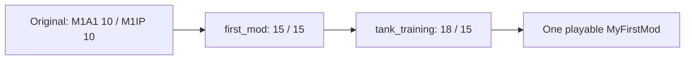

# 6. Add an optional training project

[All documentation](../README.md#beginner-course)

| Previous | You are here | Next |
| --- | --- | --- |
| [5. Finish the menu and own its assets](05-menu-and-assets.md) | Learn · 6. Add an optional training project | [7. Rebuild, recover, and share your mod](07-maintain-and-share.md) |

Start with the completed menu and YAML health patch. Both Abrams variants have 15 HP on the tutorial data. This add-on gives just the M1A1 another 20%, leaving the M1IP at 15.



## Add a second project

The add-on consumes `first_mod`'s result: `10 × 1.5 × 1.2 = 18`.

### 1. Make the base setting portable

Keep the complete two-tank YAML patch from [lesson 4](04-calculations.md#apply-the-calculation-to-two-tanks). In `YMB/mods/first_mod/config/patch/gameplay/health/ymb.patch.yaml`, change its default `healthMultiplier` from `2` to `1.5`. Keep both `readValues` entries and the `targets` list. The shared default now gives the same result without your local override.

Remove the tutorial's `mods.first_mod` and `mods.tank_training` entries from `YMB/.ymb/config.yaml` if present. Keep unrelated settings. This makes the project files below control the lesson. Build `first_mod` once: both tanks should still have 15 HP.

### 2. Create the dependent project

Create `YMB/mods/tank_training/config/ymb.mod.yaml`:

```yaml
version: 2
id: tank_training
name: Tank Training
priority: 1
dependsOn:
  - first_mod
allowWriteToModifiedFiles: true
```

`dependsOn` brings `first_mod` into the selection. The higher priority puts this add-on later, and `allowWriteToModifiedFiles` lets it transform that project's output. It does not grant permission to edit the other project's source files.

Create `YMB/mods/tank_training/config/patch/health/ymb.patch.yaml`:

```yaml
version: 2
id: gameplay.training_health
name: Extra M1A1 health
scope: prod
dependsOn:
  - first_mod:gameplay.health
variables:
  trainingMultiplier: 1.2
targets:
  - file: GameData/Generated/Gameplay/TacticalUnits.ndf
    operations:
      - op: bulk
        match:
          conditions:
            - on: name
              is: equals
              value: Descriptor_Unit_M1A1_Abrams_US
        edits:
          - field: MaxPhysicalDamages
            multiply: ${trainingMultiplier}
            minChanges: 1
        expect:
          minBlocks: 1
```

This patch requires the specific health feature, not just the presence of the project folder. A disabled prerequisite is an error; YMB will not silently calculate from a different starting point.

### 3. Check the combined result

```text
.\YMB.exe explain --mod tank_training
.\YMB.exe build --mod tank_training
```

The explanation should include `first_mod:gameplay.health` before `tank_training:gameplay.training_health`. In `.ymb/build/output/GameData/Generated/Gameplay/TacticalUnits.ndf`, check the `TBaseDamageModuleDescriptor` inside each exact unit block:

| Unit descriptor                  | Original HP | After `first_mod` | After `tank_training` |
| -------------------------------- | ----------: | ----------------: | --------------------: |
| `Descriptor_Unit_M1A1_Abrams_US` |          10 |                15 |                    18 |
| `Descriptor_Unit_M1IP_Abrams_US` |          10 |                15 |                    15 |

Your welcome title remains. `bulk` rounds integer fields to whole numbers; keep health positive. `trainingMultiplier: 2` doubles the base project's 15 to 30 HP. Two projects writing the same file need deliberate order; alphabetical optimism is not a dependency plan.

When the preview matches:

```text
.\YMB.exe sync --mod tank_training --yes
```

Run `GenerateMod.bat` in `WARNO/Mods/MyFirstMod`, then enable `MyFirstMod` in WARNO and check its M1A1. Both mod projects are compiled into that one WARNO mod folder. `tank_training` is not a second in-game checkbox.

To remove this add-on's extra HP, build and sync `first_mod` alone, then compile. The shared `TacticalUnits.ndf` returns M1A1 to 15 HP. This works because the add-on changes only that shared file; other projects can need a different uninstall procedure.

### Checkpoint and experiment

Predict the result of `trainingMultiplier: 2`, then build. M1A1 becomes 30; M1IP stays 15. The add-on doubles the base project's 15, not the game's original 10. Restore `1.2`, rebuild, and leave the final preview at 18 and 15.

Use `build --mod tank_training --require-all` before sharing this combination. The [composition guide](../advanced/composition.md) explains independent contributors, generated regions, and conflict files.

| Previous | You are here | Next |
| --- | --- | --- |
| [5. Finish the menu and own its assets](05-menu-and-assets.md) | Learn · 6. Add an optional training project | [7. Rebuild, recover, and share your mod](07-maintain-and-share.md) |
