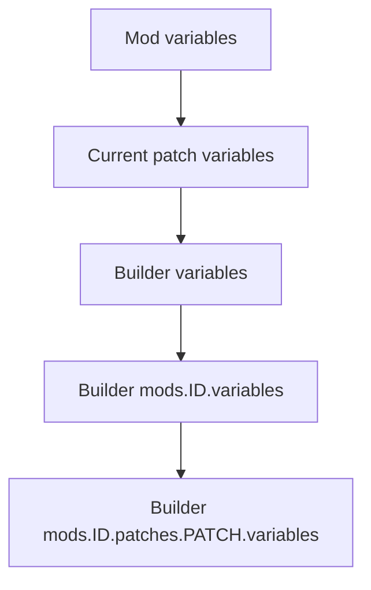

# Project files, settings, and assets

[All documentation](../README.md#reference)

| Previous | You are here | Next |
| --- | --- | --- |
| [NDF selectors and operations](ndf-patches.md) | Reference · 2/7 · Project files, settings, and assets | [Variables, expressions, and helpers](expressions.md) |

| You need to… | Go to |
| --- | --- |
| Change a downloaded project's settings | [Local overrides](#customizing-installed-mods), [value precedence](#where-a-value-comes-from) |
| Write a project or feature | [Layout](#project-layout), [mod keys](#the-mod-file-ymbmodyaml), [patch keys](#the-patch-file-ymbpatchyaml) |
| Select and order features | [Scope](#scope-prod-and-dev), [dependencies](#dependson-between-patches), [optional targets](#optional-features-built-on-game-data-that-may-not-be-there) |
| Ship assets or edit NDF | [Replacements](#replace-files), [file operations](#file-operations), [source roots](#source-roots), [NDF targets](#ndf-targets), [required references](#blocks-that-must-stay-reachable) |
| Add calculations or code | [Variables](#variables), [game reads](#reading-values-out-of-the-game), [generators](#generators-and-tests) |
| Configure YMB itself | [Paths and limits](#builder-settings-ymbconfigyaml), [temporary paths](#temporary-paths) |

For a worked local override, follow [lesson 3](../learn/03-settings.md).

## Which file to edit

| File | Owner and purpose |
| --- | --- |
| `YMB/ymb.config.yaml` | Shared builder defaults, paths, limits, and project overrides. Ships with the builder. |
| `YMB/.ymb/config.yaml` | Your installation's overrides. Merges over the root file; keep a backup before resetting `.ymb` or replacing YMB. |
| `YMB/mods/PROJECT/config/ymb.mod.yaml` | Project identity, shared variables, generator registrations, release metadata, and download dependencies. |
| `YMB/mods/PROJECT/config/patch/FEATURE/ymb.patch.yaml` | One selectable feature's NDF operations, assets, variables, generators, and prerequisites. Folder nesting does not add inheritance. |
| `config/replace/...` | Whole-file templates and assets; these are output inputs, not builder settings. |
| A generator's `Cargo.toml` and `Cargo.lock` | Optional Rust code, dependencies, compiler requirements, and locked versions. See [generators](generators.md). |
| `YMB/sdk/.cargo/config.toml` | Shipped SDK compilation defaults. Source checkouts use `YMB/.cargo/config.toml`; these do not configure gameplay. |

`init` writes commented configs with every supported top-level key and optional examples. Unknown keys fail validation.

- Indent YAML with spaces; `#` starts a comment.
- Keep one valid document per file. JSON is accepted too.
- Quote descriptions containing `: ` and version ranges with comparison operators.

YMB maintains recovery journals, source receipts, cache manifests, distribution checksums, and `.ymb/engine`. Change their inputs or use the matching command. Hand-editing a checksum is an ambitious way to make recovery worse.

## Customizing installed mods

1. Put the editable project under `YMB/mods/`, with `config/ymb.mod.yaml` inside it. Compiled Workshop files are a different deliverable.
2. Run `list` for project and patch ids, then check the project's supported variables. Commands use the project id even when its folder has another name.
3. Put personal choices in `.ymb/config.yaml`. Remove an override to restore the project default.

The tutorial's names are `first_mod`, `gameplay.health`, and `health`; another project may use different ones. Unknown project or patch ids fail. A variable nobody reads does nothing.

Keep shared defaults in root `ymb.config.yaml` and commit them with the project. Local settings merge over those defaults.

| Update method | What to preserve |
| --- | --- |
| Portable YMB archive | It replaces shared defaults and leaves `.ymb/config.yaml` intact. Back up edited root defaults. |
| Mod deploy installer | It confirms full recovery, then replaces YMB. Keep an external backup or use its documented preservation option. |
| Project update | Keep persistent identity stores, including files named "generated". |

Composition tools can override `priority` and `allowWriteToModifiedFiles` under `mods.<id>` without editing the distributed project. Layering still needs explicit order and write permission.

Set `mods.<id>.ignoreUnknownPatches: true` when retaining overrides for patches removed in another version. YMB warns about those entries and keeps the file intact. The default is strict; unknown project ids remain errors.

### Where a value comes from

YMB first merges `.ymb/config.yaml` over root `ymb.config.yaml`. The combined builder settings then override project defaults in this order:



Lower entries win. The tutorial uses the last entry to affect only `gameplay.health`.

| Value type | Merge rule |
| --- | --- |
| Object | Merge members recursively |
| List | Replace the whole list; `[]` clears it |
| Number, string, boolean, `null` | Replace the previous value |

Expressions resolve after merging. Built-ins such as `modId` are reserved.

Patch variables do not affect the project's other patches, mod-wide generators, or replacement files. Folder nesting organizes patches; it does not create variable inheritance.

## Project layout

After the first two lessons, the files you edit are here:

```text
YMB/mods/first_mod/
└── config/
    ├── README.md
    ├── ymb.mod.yaml
    ├── patch/
    │   ├── gameplay/health/ymb.patch.yaml
    │   └── welcome/ymb.patch.yaml
    └── replace/
        └── GameData/Localisation/${modRootName}/INTERFACE_OUTGAME.csv
```

YMB discovers projects through `config/ymb.mod.yaml`, finds patches recursively under `config/patch/`, and copies `config/replace/`. Generators need explicit registration. READMEs and art sources are not included automatically.

The folder containing `ymb.mod.yaml` is the operational root. Persistent storage goes in `config/.ymb/`; releases go in `config/dist/`. Within the project folder, ordinary builds write only inside config. Release preparation reads extra project files only through `release.include`.

| Storage | Contents and lifetime |
| --- | --- |
| `mods/PROJECT/config/.ymb/` | Persistent generator binaries, source receipts, license records, identities, and other generated data. Ships in mod archives and survives cleanup. Removing it discards that data; missing generators require Rust to rebuild. |
| `YMB/.ymb/mods/ID/` | Installation-specific compiler work, generator execution files, and bounded SDK caches. Omitted from mod archives. A different installation starts with fresh session storage. |

SDK generators obtain these paths from `ctx.persistent_root()` and `ctx.session_root()`. The reserved variables `modPersistentRoot` and `modSessionRoot` expose the same absolute paths. Use transactional persistent helpers for identities and SDK cache helpers for derived results; see the [SDK reference](generators.md#context-and-tools).

## The mod file: `ymb.mod.yaml`

The starter declares stable titleToken and detailToken variables. Keep those entries when adding project-wide settings.

| Field                       | Required | Meaning and default                                                             |
| --------------------------- | :------: | ------------------------------------------------------------------------------- |
| `version`                   |   Yes    | Config format; use `2`                                                          |
| `id`                        |   Yes    | Permanent project id, `first_mod` here                                          |
| `name`                      |   Yes    | Display name; also used by the starter's menu title                             |
| `description`               |    No    | Short description; used by the starter's title tooltip                          |
| `requires` | No | Compatible YMB version range; omitted accepts this builder's supported format |
| `release` | No | Mod version, optional direct archive download link, and extra files to include |
| `dependencies` | No | Download dependencies offered or required by a deploy installer; separate from build ordering |
| `enabled`                   |    No    | `true`; `false` excludes the project                                            |
| `dependsOn`                 |    No    | `[]`; project ids that must run first                                           |
| `priority`                  |    No    | `0`; lower values run earlier, subject to dependencies                          |
| `allowWriteToModifiedFiles` |    No    | `false`; opt into [ordered layering](../learn/06-combine-projects.md#add-a-second-project) |
| `variables`                 |    No    | Values available throughout this project                                        |
| `readValues`                |    No    | Values read from game data before patches run                                   |
| `generators`                   |    No    | Registered generator entries                                                   |
| `tempPaths`                 |    No    | Working files that cleanup may remove                                           |

Quote `requires`, the semantic YMB version requirement. Accepted forms include requires: "2", requires: "2.0", requires: "2.0.0", and requires: ">=2, <3". The last accepts YMB 2 releases. YMB checks against the application version in the root Cargo manifest.

Keep `id` stable after use because ownership and recovery depend on it. Rename `name` when you want different display text.

All supported configuration fields are available to expressions and generators
through the reserved [`config` namespace](expressions.md#built-in-variables).
Use `config.mod.release.version` for generated version labels so their value
comes from the same field as the release archive.

Ids use letters, numbers, dots, underscores, and hyphens. Windows device names such as `CON` and `NUL`, `.`, `..`, and trailing dots are invalid. Recover installed output before migrating an old unsupported id.

### Release settings and download dependencies

```yaml
release:
  version: "2.0.0"
  url: https://github.com/Yokaiste/WTO/releases/latest/download/WTO-config.zip
  include: [LICENSE, NOTICE]
dependencies:
  - url: https://github.com/Yokaiste/YSM/releases/latest/download/YSM-config.zip
    required: false
    reason: Add YSM's sandbox features alongside WTO.
```

| Key | Default | Behavior |
| --- | --- | --- |
| `release.version` | Current YMB version | Semantic version recorded in the mod's package manifest. Set it explicitly so your mod can have its own release schedule. This is different from the top-level configuration `version: 2`. |
| `release.url` | Omitted | Where the deploy installer downloads this mod. Without it, release creates only an archive. A compatible Rust installation is also required to include the deploy EXE. |
| `release.include` | `[]` | Extra files or folders relative to the enclosing project folder, such as `LICENSE`, `NOTICE`, or `legal/`. Their relative paths are preserved. Configuration and its `.ymb` storage are always included; `dist`, Cargo targets, and Git internals are omitted. Paths cannot escape the project or overlap its configuration folder. |
| `dependencies[].url` | Required per entry | Download link for another mod. The downloaded archive supplies its own project id, requirements, and further dependencies. |
| `dependencies[].required` | `false` | `true` downloads and installs the dependency automatically. `false` or omission offers it to an interactive user. |
| `dependencies[].reason` | Omitted | One line explaining the optional dependency. Shown in its prompt and installer help. |

Both URL fields need a direct HTTPS ZIP download. HTTPS redirects, query strings, and endpoints without `.zip` work; repository and release pages fail. The example's GitHub latest-asset link follows the latest release directly. Remote mod downloads verify their embedded manifest and need no checksum sidecar.

Each archive contains one project folder, `config/ymb.mod.yaml`, and a package manifest. Its config supplies the project identity.

| Deployment rule | Behavior |
| --- | --- |
| Required dependencies | Resolve and install before dependents |
| Invalid dependency graph | Cycles and conflicting identities stop deployment |
| Optional dependencies | `--yes` skips them; repeat `--with URL` to select them |
| Short dependency name | A simple archive filename without `-config.zip` also works |
| Offline archives | One `--project ZIP` per selected project and one `--builder ZIP`, each with a checksum sidecar |
| Offline matching | Declared URL, or an unambiguous archive filename and project-folder match; extensionless URLs need a matching URL in the offline config |

`dependencies` controls installation. `dependsOn` controls build order among installed projects and never downloads anything. Use both when a project must be installed and must run first. WTO lists YSM as optional so it can also run by itself.

Run `YMB.exe release --mod ID` from YMB to package every feature, including disabled and development features. It prepares all source generators: verified unchanged binaries work without Rust; missing, changed, or unverifiable ones use normal Rust setup. Success replaces `PROJECT/config/dist/`; failure retains the previous distribution and preview. See [the release guide](../advanced/mod-releases.md).

### GitHub publishing settings

Mod projects inherit `.github/release.json`. Any of these fields under `release` in `config/ymb.mod.yaml` overrides its default. Lists replace the whole default list. `init` includes the defaults and workflow in every new project. These settings affect GitHub publishing; local `release` still saves its verification files in `config/dist`.

YMB's own releases use the same fields in `resources/release/config.json`. Files in `resources/release/structure` become the package root. YMB defaults to version-only titles and a short description covering setup, documentation, licensing, community help, and checksums.

| Field | Default for mods | Behavior |
| --- | --- | --- |
| `title` | `{{version}}` | Nonempty release title on one line |
| `description` | Mod name, description, setup, YMB links, checksums | Markdown; missing `{{checksums}}` is appended automatically |
| `assets` | Config ZIP, deploy EXE, third-party notices and Rust license | Filename patterns in `dist`; missing optional files are skipped. The config ZIP must be included. `.sha256` files are always excluded from uploads. |
| `draft` | `false` | Leave the completed release as a draft; drafts never become latest. A previous published release is retained under a backup tag until a later non-draft run. |
| `generateNotes` | `false` | Append GitHub's generated notes to the configured description |
| `discussionCategory` | `''` | Optional GitHub discussion category name |
| `managedTags` | `^(?:stable|preview)$` | Anchored .NET regex for release tags this workflow may clean up; `''` retains old release tags |
| `branches` | `master` → `stable`, `dev` → `preview` | Branch rules; `[]` disables publishing |

Each branch rule needs either an exact `name` or an anchored .NET `pattern`, plus a `tag` template. A branch matching two rules is an error. Patterns may capture `version` and `preview` with `(?<version>...)` and `(?<preview>...)`. Without a version capture, the project's release version is used; YMB reads its Cargo workspace version.

`prerelease` and `latest` accept `true`, `false`, or `auto`; omission means `false`. Automatic previews include explicit preview captures, semantic prereleases, and versions newer than the branch explicitly marked latest. Automatic latest selects the highest stable version when no active branch explicitly owns latest. Only one release may own latest, and it must be stable. When branches share a tag, the explicit latest branch wins, then the highest version.

| Placeholder | Value |
| --- | --- |
| `{{version}}`, `{{major}}`, `{{minor}}`, `{{patch}}` | Package version and its numeric parts |
| `{{branch}}`, `{{tag}}` | Source branch and release tag; `tag` is available in titles and descriptions |
| `{{previewSuffix}}` | `-pre` for a preview; otherwise empty |
| `{{checksums}}` | SHA-256 values for every uploaded asset, in a text block |
| `{{modName}}`, `{{modDescription}}` | Mod display name and description |
| `{{project}}`, `{{instructions}}` | Mod project folder name and setup instructions for the included assets |

Branch tags accept version, branch, and preview-suffix placeholders. The mod placeholders are available only in mod titles and descriptions. Placeholders expand once, so text in a mod's name or description stays literal. Rendered descriptions must fit GitHub's 65536-character limit. Invalid settings stop publishing before an existing release is replaced. Uploads complete in a draft before channel tags move; a failed promotion retains the previous release under a backup tag.

## The patch file: `ymb.patch.yaml`

See [the health lesson](../learn/02-unit-health.md#try-a-complete-example) for a complete patch file.

| Field         | Required | Meaning and default                                       |
| ------------- | :------: | --------------------------------------------------------- |
| `version`     |   Yes    | `2`                                                       |
| `id`          |   Yes    | Stable id, unique within this project                     |
| `name`        |   Yes    | Name shown in YMB's reports                               |
| `scope`       |   Yes    | `prod` or `dev`                                           |
| `description` |    No    | Short description                                         |
| `enabled`     |    No    | `true`                                                    |
| `dependsOn`   |    No    | `[]`; prerequisite patches                                |
| `variables`   |    No    | Defaults for this patch                                   |
| `readValues`  |    No    | Values read before patching                               |
| `files`       |    No    | File and directory operations                             |
| `targets`     |    No    | NDF files and their operations                            |
| `optional`    |    No    | `false`; skip the patch if required target data is absent |
| `generators`     |    No    | Generators owned by this patch                    |
| `tempPaths`   |    No    | Declared working files                                    |

A patch needs at least one entry in `files`, `targets`, or `generators`. Unknown keys and misplaced settings are errors.

An NDF operation can declare `allowNoChange: 'compatibility: the optional source module may be absent'`. Give a specific reason; notices include it in `expected`. This permits an intentional no-op. Invalid selectors, ambiguity, required counts, syntax errors, and ownership conflicts still fail. Comment why compatibility handling belongs in a main patch when you keep it there.

### Scope: prod and dev

`prod` patches are included by default. `--scope dev` includes both `prod` and `dev` patches. The local `enabled` setting still applies in either scope.

### dependsOn between patches

Use a dependency when a patch needs something an earlier patch creates. The health patch edits an existing game unit, so it needs no dependency on the title.

Local dependencies use patch ids; cross-project dependencies use `modId:patchId`. Missing, disabled, or circular dependencies fail. Disabling a prerequisite leaves its dependents enabled, so they report an error.

<details>
<summary>Example: resize the starter title after adding it</summary>

For example, a later patch that resizes the title added by `init` must depend on `welcome_title`. To try it, create `config/patch/ui/title-size/ymb.patch.yaml` inside `first_mod`:

```yaml
version: 2
id: ui.title_size
name: Smaller welcome title
scope: prod
dependsOn:
  - welcome_title
targets:
  - file: GameData/UserInterface/Use/OutGame/UISpecificOutGameWelcomeView.ndf
    operations:
      - op: modify
        selector:
          kind: field
          by: path
          value: UISpecificOutGameWelcomeDescriptor.Components.[ElementName="YmbTitlefirst_mod"].TextSize
        value:
          $string: '40'
```

Build `first_mod` and find `YmbTitlefirst_mod` in the preview's welcome-screen NDF. Its active `TextSize` line should now contain `'40'`; the original `"50"` remains in a comment. After sync and compilation, the same title appears smaller.

This optional patch can stay in the project.

</details>

### Optional: features built on game data that may not be there

| Situation | Result |
| --- | --- |
| `optional: true` and a target file or object is absent | Skip the whole patch, report why, discard its staged writes |
| Invalid path, syntax, config, conflict, or generator failure | Fail the build |
| `optional` without `targets` | Invalid configuration |
| Deliberately unwanted feature | Use `enabled: false` |
| `remove` target already gone | Report `W9`; the command can complete with that warning |

Leave `optional` off in the health lesson so a broken tank selector gets reported.

Use `build --require-all` for release checks so optional features must apply successfully.

## Replace files

Whole-file replacements supply every byte at the target. Use them for files your project owns. Replacing the game's full `TacticalUnits.ndf` also freezes every unrelated unit, so use focused patches for health edits.

Text substitution covers `.csv`, `.ini`, `.json`, `.md`, `.ndf`, `.txt`, `.xml`, `.yaml`, and `.yml`. Other extensions copy as bytes. Paths accept variables too.

<details>
<summary>Example: the starter title and tooltip CSV</summary>

The starter already supplies a file this way:

```text
YMB/mods/first_mod/config/replace/GameData/Localisation/${modRootName}/INTERFACE_OUTGAME.csv
```

Open it. Its title entry uses `${titleToken}` and `${modName}`. The built file lands at:

```text
MyFirstMod/GameData/Localisation/MyFirstMod/INTERFACE_OUTGAME.csv
```

During a preview, the same target path is under `YMB/.ymb/build/output/`. Changes belong in the source template.

To customize the title's tooltip, change `description` beside `name` in `ymb.mod.yaml`. In YAML:

```yaml
description: The Abrams can take a little more punishment.
```

The commented starter already has a `description` entry; edit that value. Build again. The preview CSV row whose key matches `detailToken` should contain that sentence. After sync and compilation, hovering over the welcome title should show it.

</details>

## File operations

Patch-level `files` entries make assets follow feature selection. [Lesson 5](../learn/05-menu-and-assets.md#let-the-text-asset-follow-the-feature) has a complete patch.

<details>
<summary>Example: move the starter CSV into its welcome feature</summary>

For an existing YAML patch:

1. Create `config/patch/welcome/assets/`.
2. Move `config/replace/GameData/Localisation/${modRootName}/INTERFACE_OUTGAME.csv` to that folder.
3. Add this top-level block to the existing welcome patch, alongside `targets`:

```yaml
files:
  - op: copy
    source:
      root: patch
      path: assets/INTERFACE_OUTGAME.csv
    destination: GameData/Localisation/${modRootName}/INTERFACE_OUTGAME.csv
    expect:
      files: 1
```

Build `first_mod`. The same preview CSV should contain the same title and tooltip. Move the original; leaving a second copy under `config/replace` creates two owners of one output.

The target path and variable names stay the same; the welcome feature now owns selection.

</details>

| Operation | Destination requirement                            |
| --------- | -------------------------------------------------- |
| `add`     | Must not exist                                     |
| `copy`    | May exist; creates or refreshes it                 |
| `replace` | Must exist                                         |
| `remove`  | May be absent; reports `W10` if there is nothing to remove |

- Writes use `source` and `destination`; removal uses `target`.
- A directory source copies its contents below the destination. A file source writes exactly to it.
- Directory removal affects regular files. `expect.files` requires an exact positive count.

### Source roots

| `source.root`   | `source.path` starts at             |
| --------------- | ----------------------------------- |
| `patch`         | Folder containing the patch config  |
| `mod`           | Project's `config/` folder          |
| `game`          | Configured WARNO mod folder         |
| `exampleAssets` | WARNO's `Mods/ExampleAssets` folder |

Paths support variables. Text from `patch` and `mod` sources also supports content substitution. `game` sources read saved original bytes for tracked files. Sources from `game` and `exampleAssets` remain byte-exact, including text.

Operations within a patch run in order. Declare dependencies when different patches share a target; use [ordered layering](../learn/06-combine-projects.md#add-a-second-project) across projects.

Targets must stay below `GameData/` or `CommonData/`, with that capitalization. YMB rejects either root itself, escaped paths, symlinks, junctions, invalid Windows names, and a file that is also another output's parent directory.

Preview removals appear in `deletions.json`. Sync saves originals before deleting files, and recovery restores those originals.

## NDF targets

The health patch targets `GameData/Generated/Gameplay/TacticalUnits.ndf`. The welcome patch targets `GameData/UserInterface/Use/OutGame/UISpecificOutGameWelcomeView.ndf`. Each target declares an ordered `operations` list; later operations see earlier results.

See [NDF operations](../learn/02-unit-health.md) for the single-unit, loop, and bulk versions of the health change.

### Blocks that must stay reachable

`targets[].expect.referenced` takes a list of block names that must be referenced in the finished project, including from other files. Use it for generated objects whose behavior depends on such a reference.

Do not add it to every block. WARNO loads some roots by name; an absent textual reference does not prove they are unused. The health and welcome patches do not need this extra check.

An unmet required reference fails the build. An optional patch can be skipped for this missing-target condition.

## Generators and tests

Init needs no generator. Add one when a feature needs program logic, as in the [health generator lesson](generators.md).

Register a stable id and entry in the owning mod or patch config:

~~~yaml
generators:
  - id: health
    project: generator/Cargo.toml
    binary: scale-health
    entry: generate
    tests:
      - {id: health_checks, when: before}
~~~

Paths start at the declaring config folder. The binary selects a Cargo target; entry and test ids name registered functions. Keep id and entry stable.

Source registrations need no executable path: builds and releases save compiled binaries and receipts in the mod's `.ymb/g/`. Executable-only registrations can point to an authored program inside config.

| Generator key | Default and use |
| --- | --- |
| `id` | Required stable registration id. |
| `enabled` | `true`; ordinary builds skip disabled entries. Release prepares their code so users can enable them later. |
| `root` | `owner` starts paths at the declaring config folder; `mod` starts at the project's `config/`. |
| `project` | Optional Cargo manifest or its containing directory; required when no executable is registered. |
| `binary` | Optional Cargo binary target; select it when the project has multiple binaries. |
| `executable` | Optional compiled program. With source, YMB verifies its source receipt before reuse. |
| `entry` | Registered generator function; defaults to `id`. |
| `tests` | `[]`; each entry is a test id or `{id: NAME, when: before}`. `when` accepts `before` or `after`; the short form uses `before`. |

| Phase or command | Authored writes |
| --- | --- |
| Before-tests | Isolated overlay |
| After-tests | See output and staged identities; their own writes are discarded |
| Validate or dry run | Discard all authored writes |
| Successful build or sync | Commit generator writes after the whole operation succeeds |

Generators are trusted programs and can access the machine outside these helpers.

## Variables

The health lesson uses `variables.health` and `value: ${health}`. [Lesson 4](expressions.md) adds calculations and reads the original game value.

Keep feature-specific defaults in the feature's patch. Put a variable in `ymb.mod.yaml` when several parts of the project need it.

## Reading values out of the game

The original M1A1 health is available through:

```yaml
readValues:
  baseHealth:
    file: GameData/Generated/Gameplay/TacticalUnits.ndf
    path: Descriptor_Unit_M1A1_Abrams_US.ModulesDescriptors.[TBaseDamageModuleDescriptor].MaxPhysicalDamages
```

Each entry has `file` and `path`. It becomes a variable, `baseHealth` here. [The calculation lesson](expressions.md) provides a complete health patch that uses this read.

Numeric values become numbers. Other values arrive as written, including quotes or list syntax. An explicit variable with the same name wins. Missing inputs fail with their location.

Reads happen before patches and use original game data. They cannot read a file first created by the same build. Use generator target readers when you need earlier generated output.

## Temporary paths

The starter writes no temporary files inside its project, so it needs no `tempPaths` entry. Later generators can declare working paths for `cleanup`.

A plain path is disposable. An object with path and unsafeToRemove: true protects that path and its contents from cleanup. Keep identities and authored data out of disposable paths.

Paths are relative to the declaring config folder and must stay inside it. The declaring folder itself cannot be disposable.

## Builder settings: ymb.config.yaml

Root `ymb.config.yaml` ships with YMB and holds shared defaults; keep it in source control. Optional `.ymb/config.yaml` holds local overrides and disappears when `.ymb` is reset.

Start either file with `version: 2`. Blank or fully commented files are invalid. If neither exists, YMB uses built-in defaults.

~~~yaml
version: 2
paths:
  gameRoot: ..
  sourceMods: mods
  workRoot: .ymb/build
  cacheRoot: .ymb/cache
  recoveryRoot: .ymb/state
  operationLockRoot: .ymb/lock
  stateTransactionRoot: .ymb/transaction
~~~

Paths may be absolute or relative to YMB. Keep these roots separate from one another and live GameData/CommonData. A writable auxiliary root must not contain the builder or WARNO mod folder. Run doctor after changing paths.

| Path key | What it contains and when to change it |
| --- | --- |
| `gameRoot` | WARNO mod data beside `GenerateMod.bat`. Change it only when targeting another prepared WARNO mod folder. |
| `sourceMods` | Editable project folders. It is separate from the game's compiled Workshop output. |
| `workRoot` | Staged execution files and the last preview. Safe to recreate after operations finish. |
| `cacheRoot` | Bounded result caches inside this builder's `.ymb`; changing it does not move saved originals. |
| `recoveryRoot` | Saved original files and ownership records. Recover or migrate them before changing this path. |
| `operationLockRoot` | Shared command lock. Other programs and installers must use the same root. |
| `stateTransactionRoot` | Interrupted write journal and rollback data. Finish recovery before moving it. |

Top-level builder `variables` override project and patch defaults across this installation. `mods` maps project ids to narrower overrides. Neither block changes the authored project files.

| Per-project override | Default and meaning |
| --- | --- |
| `enabled` | `null` keeps the authored value; `true` or `false` selects or disables the project. |
| `priority` | `null` keeps its authored ordering priority; an integer overrides it. Explicit dependencies still determine ordering. |
| `allowWriteToModifiedFiles` | `null` keeps authored permission; set a boolean only when intentionally composing projects on shared files. |
| `allowUnsupportedYmb` | `null`; an exact YMB version permits a `requires` mismatch on that version only. See the exception below. |
| `ignoreUnknownPatches` | `false`; `true` retains removed patch overrides and reports a warning. Unknown project ids still fail. |
| `variables` | `{}`; merged over this project's variables. |
| `patches` | `{}`; maps patch ids to `enabled` (`null` keeps authored selection) and `variables` (`{}` by default). No other patch keys can be overridden here. |

For example, keep one health change local without modifying a shared download:

```yaml
version: 2
mods:
  first_mod:
    variables:
      health: 30
    patches:
      gameplay.health:
        enabled: true
```

Deploy records `allowUnsupportedYmb` in `.ymb/config.yaml` after explicit consent to try an unsupported builder. It preserves the authored requirement and all generator protocol checks. Remove the exception to restore normal version checking.

### Path restrictions and installation discovery

cacheRoot must stay inside this builder's .ymb. These reserved directories cannot overlap configured roots:

| Directory | Reserved for |
| --- | --- |
| .ymb/target | Builder compilation |
| .ymb/mods | Mod session storage |
| .ymb/releases | Release preparation |
| .ymb/engine | Portable Rust |

Doctor and recovery can read older custom layouts to keep saved originals accessible.

Without --ymb-path, YMB finds its installation through configuration, a release manifest, or the source layout above its executable, then falls back to the current directory. Use --ymb-path to choose explicitly. External programs can run an installed YMB.exe without changing their working directory.

### Resource limits

Put these under `settings` in either builder config. Limits are positive integers; `workerThreads` also accepts `null` for automatic selection. Start with the defaults and raise a limit only for a measured need. Bigger caches cost disk; bigger process and merge limits can cost memory and latency. None of these settings buffs your tanks.

| Setting | Default | Purpose |
| --- | ---: | --- |
| workerThreads | null | Available processors; a positive value caps worker threads |
| cacheMaxEntries | 512 | Total persistent cache entries |
| cacheMaxBytes | 1073741824 | Total persistent cache bytes |
| generatorCacheMaxEntriesPerNamespace | 4 | Entries in one generator cache namespace |
| generatorCacheMaxBytesPerNamespace | 268435456 | Bytes in one generator cache namespace |
| generatorTimeoutSeconds | 120 | Deadline for each generator or companion test |
| memoryBudgetMib | 512 | Target concurrency budget and per-generator process limit |
| mergeMaxEstimatedDiffWork | 50000000 | Maximum changed-line comparison work |
| mergeMaxTextBytesPerSide | 4000000 | Maximum changed text per side in an independent merge |
| mergeMaxTextBytesCombined | 6000000 | Maximum combined changed text in an independent merge |

Independent targets use native threads up to workerThreads or the available processor count. Jobs reserve estimated memory; smaller jobs can fit beside large ones. Small batches run directly.

The budget covers scheduled work, not total builder memory. Windows separately enforces generator process limits.


| Previous | You are here | Next |
| --- | --- | --- |
| [NDF selectors and operations](ndf-patches.md) | Reference · 2/7 · Project files, settings, and assets | [Variables, expressions, and helpers](expressions.md) |
