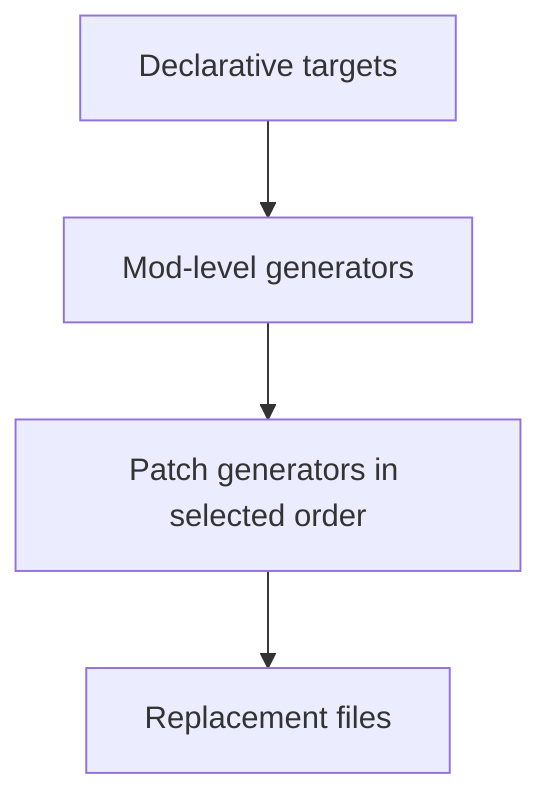

# Generator SDK and execution

[All documentation](../README.md#reference)

| Previous | You are here | Next |
| --- | --- | --- |
| [Variables, expressions, and helpers](expressions.md) | Reference · 4/7 · Generator SDK and execution | [Commands and JSON output](commands.md) |

For a complete generator and test, follow the [optional Rust lesson](../advanced/health-generator.md).

| You need to… | Go to |
| --- | --- |
| Register or ship a generator | [Registration](#registering-generators), [distribution without Rust](#distribute-without-a-compiler), [cache locations](#compilation-and-cache-locations) |
| Read inputs or write output | [Context and tools](#context-and-tools), [streaming](#stream-a-large-generated-target) |
| Share a target | [Region ownership](#owning-part-of-a-file) |
| Test and cache work | [Tests and cache](#tests-and-cache) |

## Distribute without a compiler

From PowerShell inside YMB, prepare the lesson's project:

```powershell
.\YMB.exe release --mod first_mod
```

Keep the source registration from the lesson. YMB compiles it when needed and ships the same persistent binary cache that ordinary builds use:

~~~yaml
generators:
  - id: health
    project: generator/Cargo.toml
    binary: scale-health
    entry: generate
    tests:
      - {id: health_checks, when: before}
~~~

The archive, `mods/first_mod/config/dist/first_mod-config.zip`, contains `first_mod/config/`: source, `Cargo.lock`, and `.ymb/g/` binaries with required notices. Extract into `YMB/mods/` to run without Cargo while source and cache match.

YMB keeps `project` and `binary` unchanged and saves a receipt beside the executable. Reuse checks the binary, project files, lockfile, SDK, and protocol. Missing, changed, or damaged binaries fall back to source; a verified rebuild can reuse compiler cache.

Keep compile-time inputs inside the generator project or SDK. Build scripts always need Cargo to check external inputs. Executable-only registrations also work.

### When Rust is needed

Choose automatic setup, manual installation with recheck, or cancel. Automatic setup downloads the declared Rust version, Cargo, and Windows LLVM linker components from official sources into `.ymb/engine`.

- System Rust stays unchanged. Downloads need internet; generator dependencies may need more downloads.
- Native C/C++ dependencies may need extra tools.
- Cleanup and mod updates retain the engine. Deleting `.ymb` removes it.

## Registering generators

Projects and patches can register several entries from one executable. Keep each id stable; entry names its registered function.

| Registration | Fields |
| --- | --- |
| Source | project; binary when selecting a Cargo target |
| Portable executable | executable |
| Verified source fallback | Both |

Paths stay inside the owning config. Default root: owner starts at the declaring config folder. Use root: mod to share code from the project config folder. Owner context and owned-file paths still belong to each feature, including its identity store.

Use mod-level entries for project-wide output and patch entries for features. Execution order is:



Before replacement files are applied, a generator can update an owned replacement through staged helpers.

## Owning part of a file

Use generated::render and generated::upsert for owned regions in shared files. Keep region ids stable and preserve other contributors' regions.

| Ownership detail | Rule |
| --- | --- |
| Region owner | Prefer `ctx.generator_id()`; declare it with output_generated |
| Other output | output_text, output_binary, or output_file |
| Allowed region changes | Returned `GeneratedFile.generated_block_owners` |
| Qualified ids | projectId::generatorId or projectId:patchId:generatorId |
| Delegation | Registered generators in the same project only; unknown or foreign ids fail |

Region ids and optional source labels survive recompilation and relocation. The [executable protocol](plugin-protocol.md) supports language adapters.

## Context and tools

| Context | Contents |
| --- | --- |
| `ctx.info` | Builder paths, selection, project/patch metadata, qualified generator id, cache info |
| `ctx.variables` | Merged, resolved variables |
| `ctx.value::<T>("name")` | Typed variable extraction |
| `ctx.info.builder` | Typed config, game, project, work, preview, cache, conflict, recovery, lock, and transaction paths; respects external roots |

The same [configuration snapshots](expressions.md#built-in-variables) available
to patches are included in `ctx.variables["config"]`. Use the existing typed
reader to access all builder, mod, and current patch fields:

~~~rust
let config: serde_json::Value = ctx.value("config")?;
let release_version = &config["mod"]["release"]["version"];
let dependencies = &config["mod"]["dependencies"];
~~~

`config["patch"]` is `null` for mod-level generators. Snapshots include defaults and selection overrides but leave expressions as text. Use `ctx.value("setting")` for resolved values.

Unpublished generator crates can omit their Cargo version. Keep the mod version in `ymb.mod.yaml` and read it for generated labels.

### SDK methods

| API | Purpose |
| --- | --- |
| `read_target`, `read_targets`, `read_binary_target` | Read the current eligible target snapshot |
| `read_targets_with_hashes` | Read verified text and SHA-256 hashes together for cache keys |
| `read_owned_text`, `write_owned_text`, `resolve_path` | Access files relative to the owning config |
| `read_mod_text`, `write_mod_text`, `resolve_mod_path` | Access files relative to the project config |
| `target_file`, `output_file` | Read and copy file-backed payloads without loading the whole file |
| `output_text`, `output_binary` | Create staged game outputs |
| `output_stream` | Write a large output directly to host staging through a buffered writer |
| `output_generated` | Create text output and declare this generator's region ownership |
| `persistent_root`, `read_persistent_text`, `write_persistent_text`, `persistent_path` | Use the mod's `.ymb` storage for identities and other persistent generated files; writes are staged transactionally |
| `session_root`, `session_path` | Resolve installation-specific scratch below `YMB/.ymb/mods/ID/` |
| `cache_enabled`, `cache_key`, `cache_read`, `cache_write` | Use bounded, checksummed derived results in the mod's session storage |
| `set_target_fixture` | Supply in-memory target input for a companion test |
| `patch` | Apply the same declarative operations used by YAML |
| `patch_identity` | Supply the current mod, patch, and target identity to lower-level NDF tools |

Owned reads return empty text for missing files; unchanged writes return false. Helpers cannot overwrite ymb.mod.yaml or ymb.patch.yaml. Mod-level helpers permit sharing within a project.

Resolve helpers are for read-only integration. Use write helpers for rollback protection.

### Storage and target reads

`ctx.info.storage` exposes typed `persistent_root` and `session_root` paths. Reserved variables `modPersistentRoot` and `modSessionRoot` hold the same absolute paths. Both roots belong to the whole mod; separate features with subdirectories such as `decks/`. Use persistent helpers for generated files instead of writing into authored config inputs.

Target reads see earlier patches and eligible ordered project output, otherwise original game input. A transformation must read the exact target it replaces. The host records that read and checks ordering and write permission.

### NDF readers and shared modules

NDF spans are UTF-8 byte offsets into their supplied source. Field spans cover
the member syntax; value spans exclude surrounding whitespace and trailing
comments. Use trailing_comment to read that comment separately. Readers expect
valid NDF. `values::positive_integer` accepts positive whole numbers or numeric
text up to 9007199254740991, including integral exponent notation.

| Module | Use |
| --- | --- |
| ndf | Validation, scanning, selectors, values, operations, patching |
| generated | Stable region rendering and upserts |
| text | Bounded diffs and merging |
| values | Input checks |
| core | Diagnostics, paths, templates, hashes |

`ndf::read::objects` enumerates nested objects through the NDF grammar. It excludes
metadata clauses and template roots while retaining their nested objects.
NDF readers also include parse_list and trailing_comment. Use `ndf::patch::matches`
for shared block predicates and `ndf::patch::insert_at_path` for an unmarked
collection insertion. Use `text::escape_regex` when constructing a literal
regular-expression match.


For many fields, call `ndf::read::fields` once: it returns borrowed name/value spans in source order and ignores assignments in comments and strings. Combine with direct_fields when direct fields take precedence. Repeated deep scans of one large descriptor are an expensive hobby.

### Parallel work

`parallel::map` runs independent work on scoped native threads and returns input order. Pass `parallel::Limits::from_env()` and estimate each job's working bytes. Use `parallel::Cost` for separate streaming memory and work estimates. Small batches run directly.

Allocate identities and commit authored writes in their original order after workers finish. Avoid nested parallel batches: they multiply resource limits.

### Stream a large generated target

Use output_stream to avoid another large in-memory string. Its buffered `io::Write` callback writes to host staging and submits the same checked payload as output_file. Callback failure discards it; the builder transaction controls publication.

~~~rust
let output = ctx.output_stream(FILE, ymb_sdk::ContentKind::Text, |writer| {
    writeln!(writer, "Example is TObject(Value = 1)")
})?;
~~~

The callback returns `std::io::Result<()>`. Use ContentKind::Binary for binary assets. For generated regions, set the returned file's generated_block_owners to the registered owner ids, as with output_generated. The host still validates path, length, digest, ownership, and text syntax.

## Tests and cache

Register `TestEntry {name, run}` alongside generator entries. A test returns
Vec<TestResult>. Use `TestResult::passed`, structured failures, ensure,
assert_text_present, assert_text_includes, assert_text_matches, and assert_all.
assert_all collects named assertion results, including checks that use context:

    ymb_sdk::assert_all([
        ("title", ymb_sdk::assert_text_includes(&title, "My Mod", "Title missing", "Fix the title")),
        ("hint", ymb_sdk::ensure(!hint.is_empty(), "Empty hint", "Add a hint")),
    ])?;

| Stage | Reads and authored writes |
| --- | --- |
| Before-tests | Own isolated write overlay |
| Generation | Sees successful staged writes from earlier generators |
| After-tests | Sees generation overlay; its own writes are discarded |
| Validate or dry run | All authored writes discarded |
| Successful build or sync | Generation writes committed |

Before-test cache keys include executable content, builder fingerprint, context, settings, variables, and observed target/owned input hashes. After-tests always run. Generation always executes too, preserving identity updates and other authored writes.

cache_key includes executable and SDK fingerprints. Add runtime input values or hashes; namespace and key names use the same safe characters as ids. Builder-only changes do not invalidate computation caches or recompile the SDK.

Use host reads for external source/data files so before-tests track changes. Invalid cache entries are misses. --no-cache disables SDK cache reads and writes. Keep stable identities in persistent storage; cleanup retains it.

Each execution has a configured deadline and Windows process memory limit.
Source compilation has a ten-minute deadline, increased when generatorTimeoutSeconds is larger.
Exiting, timing out, or failing closes the process job and terminates descendants.
Send logs to stderr; stdout belongs exclusively to the framed protocol.

## Compilation and cache locations

| Location | Contents and lifetime |
| --- | --- |
| `mods/PROJECT/config/.ymb/g/` | Verified binaries and receipts; ships with config, survives relocation and cleanup |
| `YMB/.ymb/mods/ID/compiler/` | Cargo intermediates; reusable across commands and failures, omitted from mod archives |
| Mod session staging | Captured execution files; removed when execution finishes |

Normal builds and releases share this layout. YMB checks project and SDK fingerprints without Rust. Missing or changed inputs invoke Cargo in release mode; untrackable inputs and build scripts require Cargo checks. Entries and tests share one captured executable and checksum per command.

`Dev.bat clean` removes builder session work and keeps mod persistent storage. `--no-cache` bypasses result caches while Cargo reuses compilation.

Build scripts must declare external files with rerun-if-changed and environment inputs with rerun-if-env-changed.

| Previous | You are here | Next |
| --- | --- | --- |
| [Variables, expressions, and helpers](expressions.md) | Reference · 4/7 · Generator SDK and execution | [Commands and JSON output](commands.md) |
