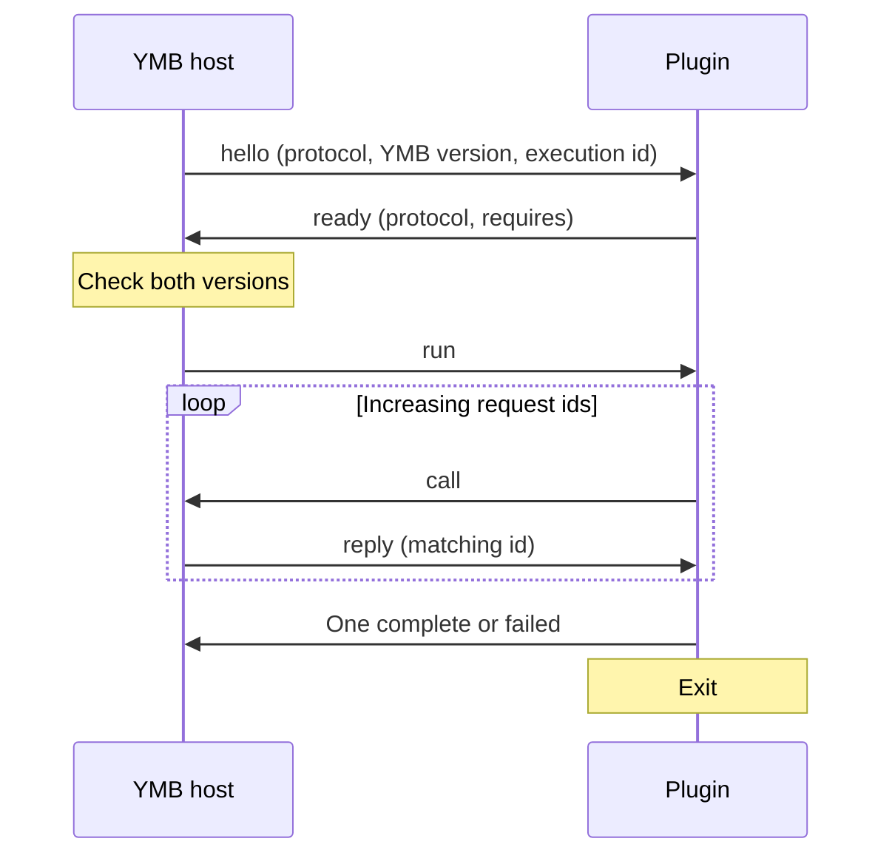

# Executable plugin protocol

[All documentation](../README.md#reference)

| Previous | You are here | Next |
| --- | --- | --- |
| [Errors, warnings, and message codes](message-codes.md) | Reference · 7/7 · Executable plugin protocol | [Documentation](../README.md) |

Executable plugins use this host contract. Ordinary patches need no adapter.

Adapters can use another language without adding a runtime to YMB. The root Cargo manifest declares the protocol version; the SDK protocol module defines all serializable types.

## Framing and handshake

| Stream or limit | Contract |
| --- | --- |
| Frame | Four-byte little-endian unsigned length, then UTF-8 JSON |
| Frame body size | 1 byte through 4 MiB |
| Stdout | Frames only |
| Stderr | Drained continuously; at most 64 KiB retained for diagnostics |

## Run context and calls

Run names an entry, phase (before, generate, after), optional testId,
and context. The context includes project and patch metadata, resolved variables,
selection, stable generator id, and cache settings.

| Purpose | Calls |
| --- | --- |
| Read target input | readTargets, readBaseTargets |
| Add a diagnostic | notice, warning |
| Access owned files | readOwned, resolveOwned, createOwned, commitOwned |
| Stage output | createOutput |
| Use cache | cacheRead, cacheCreate, cacheCommit |

Fields and variants use camelCase. Scope is owner or mod; content kind is text or binary. See the SDK protocol module for field types.

`readBaseTargets` returns the input before the current project, including earlier projects' contributions. It does not satisfy the requirement to read the current target before transforming it. Before-test caches track base reads separately. `notice` adds an informational diagnostic; `warning` adds a warning. Both are bounded and acknowledged with a `changed` reply. The context's `cacheMaxBytes` bounds one cache entry.

The SDK streams cache JSON to a bounded binary payload. Cache quota and storage failures are reported without failing otherwise valid output. Path, token, hash, and protocol checks remain mandatory.

## Payloads and failure

Large content uses staged files. Each payload names a token, path, byte count, SHA-256 hash, and kind.

1. The host issues a writable token for one output, owned file, or cache entry.
2. Return that exact path and token.
3. The host checks ownership, path safety, file type, length, hash, UTF-8 text, and NDF syntax.

Output paths are unique and game-relative. Results allow at most 10,000 outputs and 10,000 test results.

Input payloads are immutable for the command's lifetime. They are not embedded
in JSON or duplicated into every plugin process. A failed frame, process exit,
handshake, timeout, payload check, or final output check fails the operation.

Plugins run as trusted programs. Use host staging for recoverable writes and package any runtime the adapter needs for portability. The protocol checks output; it does not put the executable in a sandbox.

| Previous | You are here | Next |
| --- | --- | --- |
| [Errors, warnings, and message codes](message-codes.md) | Reference · 7/7 · Executable plugin protocol | [Documentation](../README.md) |
