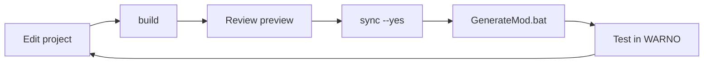

# Build, apply, and play

[Docs](README.md) / Workflow · [First build](getting-started.md)

Use this cycle throughout the `first_mod` lessons: edit the project, run `build`, inspect the preview, then run `sync` with the same selection. Compile with WARNO's `GenerateMod.bat` before testing in game. Start with [the menu-title lesson](getting-started.md) if you have not created the project yet.



## Choose a command

| Command         | Result                                                               |
| --------------- | -------------------------------------------------------------------- |
| `doctor`        | Shows resolved paths, runtime, and the state of synced files         |
| `list`          | Lists discovered mod projects and patches                            |
| `explain`       | Explains why patches are included or skipped                         |
| `find`          | Searches NDF blocks by name, type, or field                          |
| `validate`      | Runs build checks without replacing the preview                      |
| `build`         | Runs checks and writes `.ymb-build/output`                           |
| `sync --yes`    | Rebuilds, saves originals, and applies files to the WARNO mod folder |
| `recover --yes` | Restores tracked originals and removes generated additions           |
| `cleanup`       | Removes disposable previews and caches                               |
| `init`          | Creates a starter project                                            |

Use `<command> --help` for its options. Commands here use [YMB's shell](getting-started.md#where-to-type-commands).

Build and validation leave `GameData` and `CommonData` unchanged. Scripts can still update their owned project files and caches. A dry run is not a sandbox for untrusted code.

## Preview before applying

```text
build --mod first_mod
```

Open the reported preview folder. It contains the files YMB would apply; removals appear in `.ymb-deletions.json`. Check both when your patch deletes anything.

For the menu-title lesson, open `GameData/Localisation/MyFirstMod/INTERFACE_OUTGAME.csv` in the preview and check your title. For the health lesson, open `GameData/Generated/Gameplay/TacticalUnits.ndf`, find `Descriptor_Unit_M1A1_Abrams_US`, and check `MaxPhysicalDamages` inside its `TBaseDamageModuleDescriptor`. The first health exercise changes it from `10` to `20`.

```text
sync --mod first_mod --yes
```

Sync rebuilds from your current settings. If you edited the project after reviewing its preview, those newer changes are included. Keep the same filters when applying the build you reviewed.

After sync, run `GenerateMod.bat` from the WARNO mod folder and enable the compiled mod in game. YMB does not run WARNO's compiler.

Check the title on the welcome screen. For health changes, inspect the affected unit in the armory and try it in a fresh skirmish. Keep the same units and conditions when comparing results; extra HP does not change armor or make every shot deal the same damage. If the title works but health has not changed, check the descriptor you edited and the unit variant you selected.

## Choose projects and patches

```text
build --mod first_mod
build --mod first_mod --patch gameplay.health
build --mod first_mod --patch ui.branding.welcome_view --patch gameplay.health
build --mod first_mod --scope dev
```

Filters match exact ids or display names. Prefer ids in saved commands. Repeat `--mod` or `--patch` to select several; `--scope dev` includes both `prod` and `dev` patches.

Use a patch filter to investigate that feature, then build and sync `--mod first_mod` for the complete tutorial mod. To turn a feature off, change its `enabled` setting as shown in [configuration](configuration.md), then sync the whole project. Selecting fewer patches for a command is not a reliable way to uninstall the ones you left out.

YMB adds required dependencies automatically. Missing or disabled dependencies fail the build. A filter that matches nothing produces a warning, so check the reported selection before assuming a successful command changed anything.

| Option                       | Available on                          | Use                                                           |
| ---------------------------- | ------------------------------------- | ------------------------------------------------------------- |
| `--mod <id>`, `--patch <id>` | All commands except `init`            | Narrow the selection                                          |
| `--scope dev`                | All commands except `init`            | Include development patches                                   |
| `--verbose`                  | All commands except `init`            | Show the full human report                                    |
| `--no-cache`                 | `validate`, `build`, `sync`           | Recompute cached work                                         |
| `--require-all`              | `validate`, `build`, `sync`           | Fail if an optional patch cannot apply                        |
| `--dry-run`                  | `build`, `sync`, `recover`, `cleanup` | Review without applying preview or game-file writes           |
| `--yes`                      | `sync`, `recover`, `cleanup`          | Confirm the write; required for `cleanup --all`               |
| `--reset-changed`            | `sync`, `recover`                     | Discard external edits to tracked files using saved originals |
| `--ymb-path <path>`          | All commands                          | Choose a different YMB folder                                 |
| `--json`                     | All commands                          | Return structured output for programs and agents              |

`init` accepts `--id`, `--name`, and `--description` instead of selection filters. `find` also has `--name`, `--type`, `--field`, `--file`, and `--limit`.

## Undo a sync

```text
recover --dry-run
recover --yes
```

Recovery restores the originals saved before YMB first changed each file. Files created by YMB are removed. Recompile afterwards to update the playable mod.

You can narrow recovery:

```text
recover --mod first_mod --dry-run
recover --mod first_mod --yes
```

> [!WARNING]
> Recovery works on whole files. If several patches contributed to the same file, selecting one contributor restores that entire file. Build and sync the remaining selection afterwards if you want those other changes back.

Keep `.ymb-state` while any synced output needs recovery. Copies of mod projects do not replace these backups.

## Free disk space

`cleanup` removes previews, build caches, and declared disposable paths. The next build recreates what it needs. It preserves recovery data and temporary paths marked `unsafeToRemove`.

`cleanup --all --yes` also removes those protected paths and recovery data. Recover installed files first if you may need their originals. “I'll probably never need undo” is a bold storage policy.

## Read progress and warnings

Progress shows the current work and elapsed time. An estimate appears after YMB has completed a comparable run; it adjusts while the command runs. A different selection or cache state may need its own first measurement.

The summary distinguishes outputs, warnings, and skipped optional patches. Read warnings even when the command succeeds: a rule may have become redundant, a filter may have matched nothing, or an optional feature may be absent.

A cached script test is marked `test ok*`. Run with `--no-cache` when investigating a result that looks stale.

## After a WARNO update

For an existing YMB installation:

1. Back up your mod projects, `ymb.config.yaml`, and `.ymb-state`.
2. Run `recover --yes` before updating the WARNO mod's data.
3. Run `UpdateMod.bat` from the WARNO mod folder, following the game's manual.
4. Return to YMB and run `doctor`, then `build` with your usual selection.
5. Fix reported changes, review the preview, run `sync --yes` with that selection, and compile again.

If files have already changed, read [changed files](#changed-files-since-sync) before using recovery. Do not overwrite the refreshed game data with old backups blindly.

Focused patches often continue to work after updates because they find their target again. A renamed field still needs a patch update. Whole-file replacements need comparison with the new game version.

Optional patches can be skipped when required data is absent. Use `build --require-all` when preparing a release so a missing feature cannot pass unnoticed.

## Update YMB or a mod project

Keep local customization in `ymb.config.yaml`. Back it up before extracting a YMB release, which includes a default copy of that file. Preserve `mods/` and `.ymb-state/`, and follow any migration notes in the release.

When switching from the full archive to the archive without Bun, back up and remove the old `YMB/runtime/` folder. The launcher prefers its bundled `bun.exe` over the version on `PATH`; leaving the old runtime can cause a version mismatch.

For a downloaded mod project, use its update instructions. Preserve any persistent id stores it documents; regenerating them can break saved content. Then build with your usual selection before syncing. A new project version does not automatically update files already compiled into WARNO.

## Scripting YMB

Add `--json` for programs and AI agents. The CLI writes one compact JSON document to stdout without its banner, progress display, or prompts. Check the exit code and `ok`: `0` means success and `1` means failure.

From PowerShell inside `YMB/`:

```powershell
$result = & .\YMB.bat build --mod first_mod --json | ConvertFrom-Json
if ($LASTEXITCODE -ne 0 -or -not $result.ok) {
    $result.errors | Select-Object category, path, line, column, reason, suggestion
    exit 1
}
$result.data.files | Select-Object path, sourceType
```

### The JSON contract

| Field                             | Meaning                                                                   |
| --------------------------------- | ------------------------------------------------------------------------- |
| `schemaVersion`                   | Output format version, currently `2`                                      |
| `ymb`                             | YMB application version                                                   |
| `command`, `ok`                   | Command and success state                                                 |
| `selection`                       | Requested filters, scope, and build options on normal successful commands |
| `data`                            | Typed command results                                                     |
| `errors`                          | Structured failures, when `ok` is false                                   |
| `errorCount`, `omittedErrorCount` | Failure counts; all collected errors are returned                         |

| Command         | Fields to use under `data`                                                                          |
| --------------- | --------------------------------------------------------------------------------------------------- |
| `list`          | `mods`, including ids, paths, enabled state, and patches                                            |
| `explain`       | `patches` and inclusion reasons                                                                     |
| `find`          | `matches`, `matchCount`, `searchedFiles`, `limit`, `truncated`                                      |
| `doctor`        | `paths`, `runtime`, `health`                                                                        |
| `validate`      | `mods`, `patches`, `counts`, `notices`, `cache`                                                     |
| `build`, `sync` | Selected ids, `files`, `deletions`, `counts`, `notices`, `findings`, `paths`                        |
| `recover`       | `files` with restore/delete actions and contributors, `sweptBackups`, `counts`, `findings`, `paths` |
| `cleanup`       | `targets`, `preserved`, `unmatchedFilters`, `counts`, `includeRecovery`, `paths`                    |
| `init`          | `id`, `name`, `path`, `files`                                                                       |
| `--help`        | Commands, options, accepted values, and defaults                                                    |

Use structured ids, categories, paths, and numbers for decisions. Error reasons and suggested fixes are for display; their wording may change. Ignore unfamiliar additive fields.

Apply and recovery results describe individual file actions:

| Command and field                         | Record                                                                                                                 |
| ----------------------------------------- | ---------------------------------------------------------------------------------------------------------------------- |
| `sync`: `data.files`                      | `path`, `sourceType`, `contributors`, and `action`: `updated` or `current`                                             |
| `sync`: `data.deletions`                  | `path` and `action`: `deleted` or `current`; `validate` and `build` return deletion paths as strings                   |
| `sync`: `data.obsoleteFiles`              | Previously tracked files absent from the new output, with `path`, `action` (`restore` or `delete`), and `contributors` |
| `sync`: `data.resetFiles`                 | Paths whose external edits were discarded through `--reset-changed`                                                    |
| `recover`: `data.files`                   | `path`, `action` (`restore` or `delete`), and `contributors`                                                           |
| `sync` and `recover`: `data.sweptBackups` | Removed orphan-backup filenames relative to `data.paths.recovery/originals/`                                           |

`current` means the target already has the requested state. When `selection.dryRun` is true, file actions describe the plan; no apply or recovery writes occur, and `sweptBackups` is empty. `data.findings` retains warnings and notes about obsolete files and backup cleanup. Cleanup's `data.unmatchedFilters` lists selectors that matched nothing.

### Migrating from JSON version 1

Version 2 removes the duplicate human report fields `summary`, `details`, `locations`, and `nextSteps`. Read counts and results from `data`. The `init` result also drops `created` and `modsRoot`; use `data.path` and `data.files`.

For `sync`, `data.deletions` changes from path strings to `{ path, action }` records. Update consumers to read those fields; `validate` and `build` still return deletion paths as strings.

Output folders now live in `data.paths`: `preview` for builds, `game` and `recovery` for sync/recovery, and `builder` and `recovery` for cleanup. Recovery also returns `data.files` with each file's `action` (`restore` or `delete`) and contributors. Check `schemaVersion` before interpreting a saved result.

NDF syntax errors include a diagnostic `code`, 1-based `line` and `column`, and a 0-based `offset` measured in UTF-16 code units. `operationLine` locates a YAML operation; `sourcePath` identifies an authored file when available. Not every error has every location field.

`find` still limits returned matches in JSON. Check `data.truncated` and narrow the query or raise `--limit`. `--verbose` does not lift that limit.

For unattended setup, pass `init --id first_mod --name "My First Mod" --json`. For writes, pass `--yes` explicitly. Launcher failures before YMB starts, such as a missing runtime, may return ordinary text; handle a failed JSON parse as a launch failure.

## When something goes wrong

Read the reason, suggested fix, and source location. A run can report several independent failures at once. Fix the authored project files and build again.

| Problem                          | Next step                                                                                    |
| -------------------------------- | -------------------------------------------------------------------------------------------- |
| Project missing from the list    | Check `mods/<project>/config/ymb.mod.yaml` and run `doctor`                                  |
| Patch excluded                   | Run `explain` with the same filters                                                          |
| YAML won't parse                 | Check indentation, colons, and tabs                                                          |
| Selector matches nothing         | Use `find --file <target> --name <part>` and correct the selector                            |
| Selector matches several objects | Use a more specific name, type, or field match                                               |
| NDF syntax error                 | Read the excerpt and fix the source patch, replacement, or generator                         |
| Conflicting output               | Check the named contributors and [layering rules](advanced.md#layering-one-mod-over-another) |
| Backup missing or damaged        | Restore it from a trusted backup before recovery or sync                                     |
| Optional feature missing         | Run `build --require-all` to expose the underlying failure                                   |

### Changed files since sync

`doctor` distinguishes two states:

- A file is back to its saved original. YMB can apply its changes again.
- A file contains unrecognized edits. Sync stops so it does not overwrite them.

Preserve any manual changes you need in your project or elsewhere first. Then, if you intend to discard the changed tracked files:

```text
sync --mod first_mod --yes --reset-changed
```

`recover --yes --reset-changed` discards the edits and restores originals without applying a new build. The flag cannot be combined with `--dry-run`. It is a discard instruction, not a stronger troubleshooting button.

### NDF syntax errors

The starter welcome-screen patch contains a `MagnifiableWidthHeight` list. Its two dimensions need a comma:

```ndf
// Broken:
MagnifiableWidthHeight = [1500.0 90.0]

// Correct:
MagnifiableWidthHeight = [1500.0, 90.0]
```

Check unfinished assignments, missing commas between list entries, and unclosed quotes or comments. The error location refers to the NDF being checked, which may be generated output. Use the listed contributor to find what to edit.

A failed output syntax check preserves the previous preview and game files. Scripts may already have updated their own project data. Syntax checks cannot verify every WARNO type, reference, or gameplay rule.

### Interrupted operations

YMB records protected writes so it can roll back an interrupted operation. If it reports a rollback, read the affected paths before retrying. Do not delete state or lock folders while a YMB command is running. For damaged recovery records, see [advanced recovery](advanced.md#what-recovery-protects).

### Report a YMB problem

Use [YSM Community Discord](https://discord.gg/33Sqn6dTjf) for help, feedback, and bug reports. Post build failures and bugs in its troubleshooting forum.

Include the YMB version, exact command, error output, expected result, and the smallest project that reproduces it. For a mod-specific problem, include the mod's name and version too. Check logs for personal paths before posting. An AI assistant can draft that report for you.
